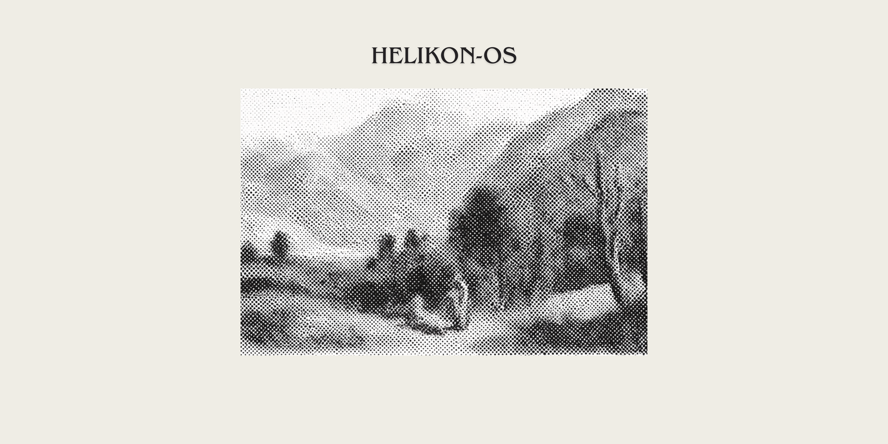

# Helikon-OS
A new bootloader and firmware for the iPod Classic 6th and 7th Generation created from the ground up. I started work on this almost a month ago, experimenting with stuff and trying some things out, I'll soon release an Alpha version with a functional bootloader and native HFS+ read/write capabilities.

# Goals
- [ ] Improved battery life over Rockbox HFS+
- [X] Cleaner interfaces
- [ ] The ability to use Rockbox skins on Helikon-OS
- [X] Improved RAM usage over Rockbox HFS+
- [X] Cleaner graphics
- [ ] Improved support for iFlash and other adapters
- [X] Improved database building on iPods (database building will happen in the companion app)
- [X] Keeping this open-source and community-friendly
- [X] Weekly firmware/bootloader updates (Upcoming planned launcher+music-player beta release ~~Sunday 8th~~ (delayed to Wednesday 11th) of November 2026 )
- [X] Clearer installation procedures
- [X] Make everything easier to use
- [X] HFS+ native without an overlay or FAT support
- [X] Active anti-corruption protection for files
- [ ] Keeping the code lightweight (wherever possible)
- [ ] (Custom) game support
- [ ] Improved DAC support
- [X] Improved read/write speeds (if possible)
- [ ] (Custom) application support
- [ ] Improved podcast support (Soon)
- [X] A companion desktop app for:
  - [ ] File tagging (Soon)
  - [ ] Metadata fetching (Soon)
  - [ ] Album descriptions and ratings (Soon)
  - [ ] Last.fm scrobbling 
  - [ ] Easy installation (Soon)
  - [ ] App, game and skin installations
- [X] Improved album view
- [X] Improved artist view
- [ ] Improved car/receiver playback
- [ ] Support a wide range of iPod devices and possibly other MP3 players
- [ ] A modern, feasible alternative to Rockbox, Rockpod or others (will be finished at the first full non-beta release)

## How Helikon-OS looks (these are previews and not finished interface screenshots):

