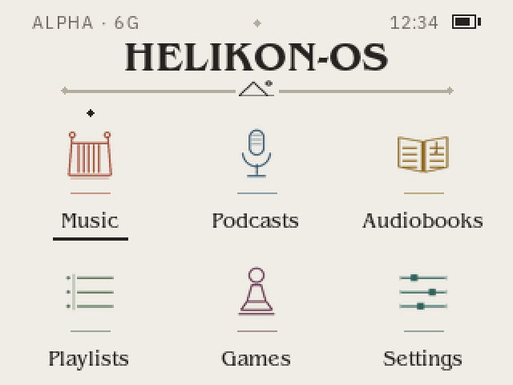
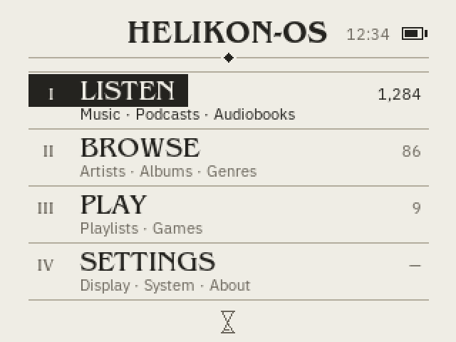
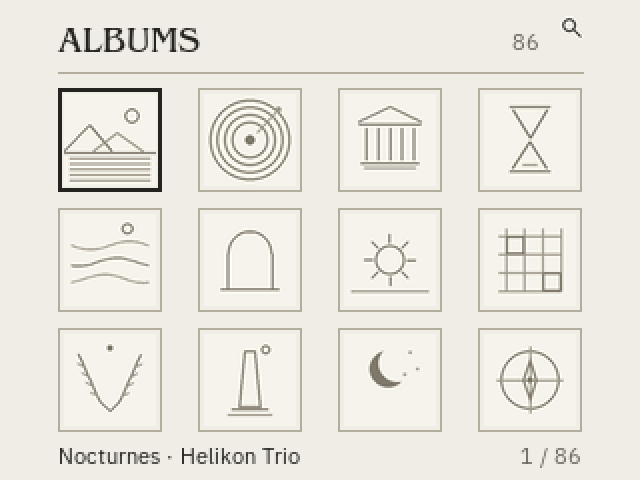
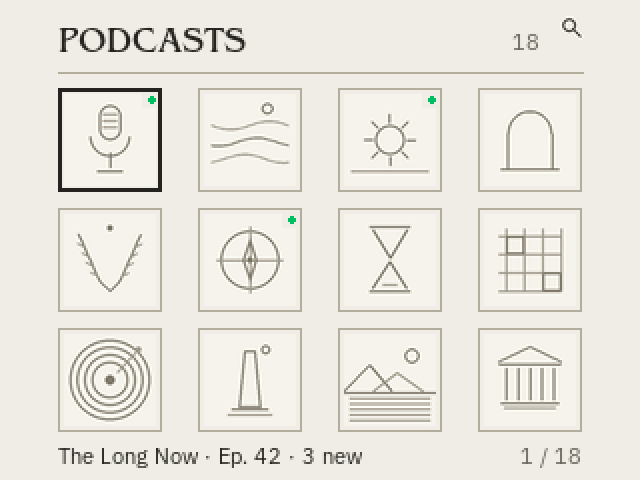
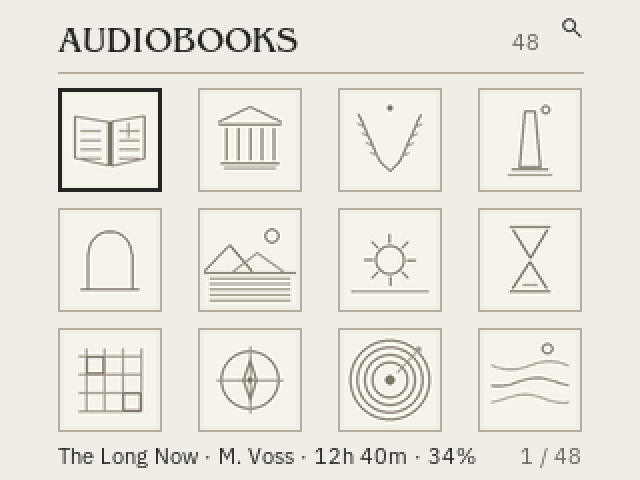
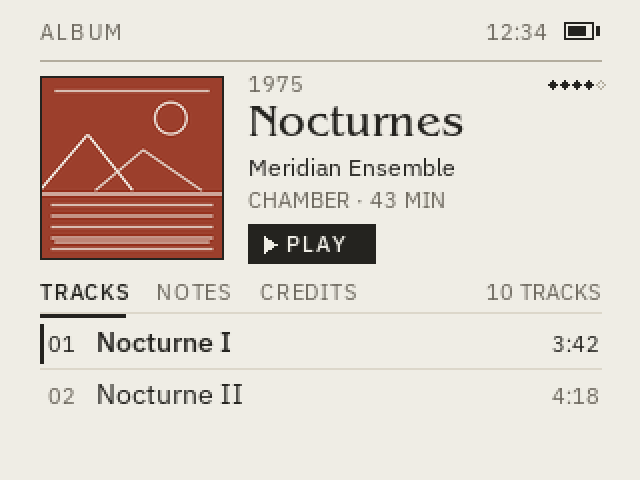
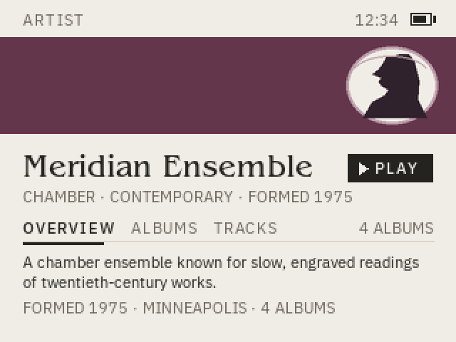
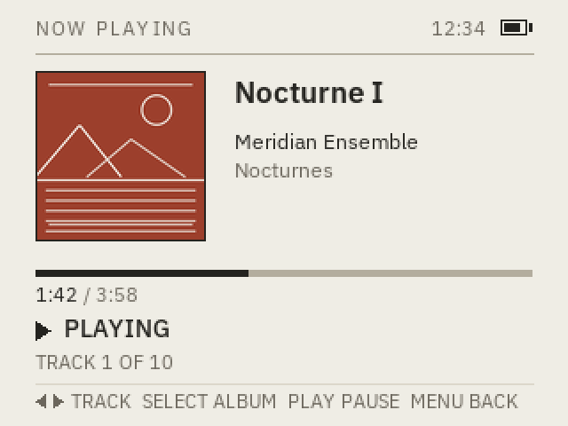
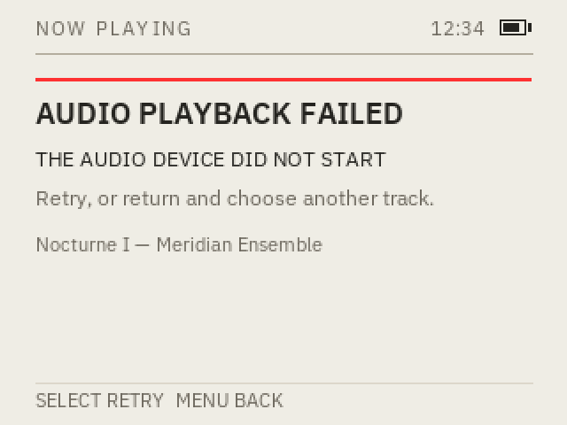

# UI design — default theme and typography

> Purpose: the first-party Helikon-OS UI look and the default typography scale.
> Status: living document; typography owner-settled, font subsets and host mockups implemented, launcher renderer implemented on host, Now Playing design and host mockups added, 6G panel run pending.
> Owner: project owner; UI lead
> Last updated: 2026-11-07
> Source: owner-supplied typography table, 2026-11-03; owner home-screen brief,
> 2026-11-05; design paper §14, §28.3.4; D-10, D-15, D-23, D-24; artist-view
> design-gate audit, 2026-11-06; `main` cf78410

This is the default first-party UI. It is not a skin format and not a promise
that a Rockbox WPS theme will render identically. Skins follow D-10 and D-15;
they may not make the first-party UI unusable.

## 1. Default typography

The iPod Classic 6G screen is 320×240. These values are for the default theme
at 1× scale.

| Element | Typeface | Size |
|---|---|---|
| Main menu | IBM Plex Sans Regular | 14 px |
| Selected item | IBM Plex Sans Medium | 14 px |
| Screen titles | IBM Plex Sans Semibold | 17 px |
| Artist / album | IBM Plex Sans Regular | 12 px |
| System information | IBM Plex Sans Regular | 11 px |
| Helikon-OS logo | Manrope Bold | Variable |

Weight mapping:

- IBM Plex Sans Regular = 400
- IBM Plex Sans Medium = 500
- IBM Plex Sans Semibold = 600
- Manrope Bold = 700 on the variable weight axis

`Variabel` in the owner table is recorded as “variable font / layout-dependent
logo size”. Confirm whether it means the variable font, a variable logo size, or
both. The logo is a wordmark, not a UI text style.

## 2. Rules

- IBM Plex Sans is the single UI family. Do not add a second UI family without an
  owner decision.
- UI text and icons use grayscale anti-aliasing. Precompute glyph masks or a
  glyph atlas; do not rasterize a full font per frame. Keep a readable 1-bit
  bitmap fallback if a font fails to load.
- Anti-aliased output must be checked on the 6G panel for contrast and clipping,
  not only on the host.
- Manrope Bold is only for the Helikon-OS logo/wordmark. It is not body, menu or
  title text.
- The selected item uses Medium at the same 14 px size as the main menu. The
  selection must be visible by weight/contrast, not by a size jump.
- Screen titles are 17 px Semibold. They are the largest UI text unless the logo
  is on screen.
- Artist/album metadata is 12 px. System information is 11 px.
- 11 px is the minimum for this default scale. Text must not clip, overlap or
  require horizontal scrolling. A large-text option remains an accessibility
  requirement.
- If a font fails to load or a glyph is missing, fall back to a readable system
  bitmap font and report the failure; the UI must remain usable. Do not silently
  substitute a proprietary font.
- The first-party UI must remain usable if a skin fails or is rejected.

## 3. Font assets and licensing

- IBM Plex Sans and Manrope are published under the SIL Open Font License.
  The licensed subsets, OFL texts, upstream sources and hashes are recorded in
  [`../assets/fonts/README.md`](../assets/fonts/README.md).
- `HelikonUI-Sans.ttf` is a renamed Latin-1 subset with the variable weight axis
  (Regular 400, Medium 500, Semibold 600). `HelikonWordmark.ttf` is a Manrope
  subset for `HELIKON-OS` at weight 700. Do not bundle the full upstream
  families; regenerate a subset only with a measured glyph list.
- The subsets are renamed because IBM Plex has a Reserved Font Name. Keep the
  OFL texts and copyright notices with the files.
- The owner-supplied mountain logo reference has an open licence/source; see
  `assets/logo/README.md`. The Manrope wordmark font is separate from that image.
- Do not copy proprietary themes, artwork, fonts or metadata.

## 4. Bootloader splash

The bootloader splash is the owner's final **green/red Alpha artwork**, not the
earlier 1-bit image. The source PNGs, the 16-colour 4bpp device representation,
the HFS+ label mask and the `#00BF63`/`#FE3131`/`#6B665C` label colours are
recorded in [`../assets/bootloader/README.md`](../assets/bootloader/README.md).
The final-splash image `6bc6927c…` was device-checked on one 6G/iFlash SD at
6.5 s startup with a clean `fsck_hfs -fn`.

The firmware first frame should continue this identity: off-white `#EFEDE5`
background, the same wordmark and type scale, and no contradictory HFS+ state.
The intended handoff is described in
[`firmware-architecture.md`](firmware-architecture.md) §9.10; it is a design
intent, not a firmware result. Do not replace the splash or the reference image
without owner approval.

## 5. Home and album-browser concepts (proposed)

> Status: owner-requested concept set; host mockups only. No renderer, 6G panel
> run or support claim. The owner will choose a home concept. The album wall is
> the album browser, not a home candidate.

The home screen has no playback element. Earlier attempts failed because a
now-playing hero or strip made the surface read as Now Playing. These concepts
keep home as a launch or index surface; playback is a separate screen. The album
wall is the one exception in role: it is the album browser, not a home.

All three use the same paper/ink palette, 1 px rules and Benguiat headers. All
names, counts and durations are sample content, not device data.

### 5.1 Palette (proposed)

| Token | Value | Use | Contrast on paper |
|---|---|---|---|
| Paper | `#EFEDE5` | page ground | — |
| Paper light | `#F5F3EB` | cover art ground | — |
| Ink | `#24231F` | primary text, selected marks, rules | 13.4:1 |
| Muted | `#6B665C` | secondary text, counts, descriptions | 4.9:1 |
| Rule | `#B3AD9E` | frames, hairlines, separators | 1.9:1 (decorative) |
| Faint | `#DCD7CA` | leader rules and inner detail | decorative |
| Live green | `#00BF63` | reserved for system status; not used here | 2.1:1 (non-text) |
| Error red | `#FE3131` | reserved for error screens | not used here |

The page stays off-white. Colour appears only in the six launcher icon accents;
the index and album wall remain monochrome. Green is a non-text status accent
and is deliberately absent from these three surfaces: none of them claims
playback or HFS+ state. Red never appears on a healthy screen.

#### Launcher accents (proposed)

| Icon | Accent | Contrast on paper |
|---|---|---|
| Music | `#9C3F2C` | 5.7:1 |
| Podcasts | `#31536B` | 6.9:1 |
| Audiobooks | `#8A6420` | 4.6:1 |
| Playlists | `#486346` | 5.7:1 |
| Games | `#64364C` | 8.2:1 |
| Settings | `#2D5F58` | 6.2:1 |

The accents are icon-line colours, not text colours. Secondary icon lines use a
58% paper mix of the same accent. No fill or wash is used behind the icons; the
page ground remains `#EFEDE5`. The divider mountain crest is ink, not an accent.

### 5.2 Concept A — phone-style launcher



A ceremonial but conventional home screen: a status folio, a larger centred
Benguiat masthead, and six frameless coloured line-icon cells. It has no
now-playing element, no content cards and no footer.

| Region | Frame (x, y, w, h) | Content |
|---|---|---|
| Top folio | 20, 8, 280, 10 | edition mark, centred diamond, time, battery |
| Masthead | 20, 26, 280, 30 | 26 px Benguiat wordmark, raised 4 px; divider unchanged |
| Divider | 40, 50, 240, 12 | two 2 px rules with end diamonds, flanking a small mountain crest |
| Grid | 24, 64, 272, 164 | two rows by three 64 px icon cells |
| Icon cell | 64 × 64 | frameless, 40 px coloured icon on a 24 px accent plinth; selected cell has an apex diamond and a 2 px label underline |
| Label | 78 × 14 below cell | 13 px Benguiat, centred |

Cells sit at x = 24, 128, 232 and y = 64, 150. The labels are `Music`,
`Podcasts`, `Audiobooks`, `Playlists`, `Games` and `Settings`. Focus runs
row-major: Music → Podcasts → Audiobooks → Playlists → Games → Settings.

The full-width rule is gone: two wider 2 px rules with small end diamonds now
flank a mountain crest under the wordmark. The wordmark sits 4 px higher; the
divider and crest did not move. The arches were removed rather than re-shaped
again; the grid is frameless. Each icon rests on a short accent plinth, and the
selected cell is marked by a small apex diamond and a 2 px underline beneath its
label.

This is the most literal “home screen” reading. It is a launcher: the six
cells are the only decisions on the surface. It does not show what is playing.
The Music cell opens the Music hub; the album and artist walls are two of its
views.

#### Firmware launcher renderer (implemented on host)

`firmware/ui/launcher.c` composes the launcher from precomputed RGB565 tiles;
`tools/make-launcher-assets.py` generates them, the Music hub cells and the
Music wall headers from the same `tools/render-ui-mockup.py` icon and layout
code. The HELIKON-OS wordmark is
rasterized from the owner-supplied ITC Benguiat Medium face at the owner's
direction; the `.otf` is not committed. Labels use the tracked IBM Plex Sans
fallback. The folio, wordmark, divider, six icons and six labels are opaque
tiles. The accent plinths, the selected cell's apex diamond and the 2 px label
underline are drawn at runtime.

The wheel and left/right move the focus row-major through the six cells with
wrap. SELECT or PLAY on Music opens the Music hub; the other cells open labelled
placeholder screens. MENU on the launcher exits. The diagnostic image
powers off after 60 s idle. The input driver clears the wheel interrupt latch
before reading the status. The launcher build attaches to the loader's
already-initialized PMU, backlight and panel instead of resetting them, so the
loader splash stays lit until the first home frame. Buttons are edge-triggered
and the wheel requires four clicks per move with a 120 ms gate, so one press
or scroll notch moves one cell. The first firmware frame is the launcher; no
debug stage list appears.

```sh
make -C firmware BOARD=6g VERSION=10 BOOTSTATE_STATE=good UI=1 \
  EXTRA_CFLAGS='-DHELIKON_DIAG_LAUNCHER' \
  BUILD=../build/firmware/6g-launcher image
```

The image stops after the LCD stage and does not touch storage.
`make -C tests/ui preview` renders the real firmware buffer to
`build/ui/launcher.png` and checks the focus marks, icon presence and
framebuffer bounds. No 6G panel run yet.

#### Music hub and library walls (functional test)

`firmware/ui/music.c` is the first functional Music section. The launcher's
Music cell opens a launcher-style hub with three cells: Albums, Artists and
Tracks. Albums and Artists use the album-wall geometry from
`assets/ui/album-wall`: a 4×3 wall of 52 px frames with 46 px art, Benguiat
headers, counts, a selected caption and a position. Artist entries without a
profile picture use a monogram. Tracks is the title-index list. The wheel or
left/right moves, SELECT opens and MENU returns one level; album, artist and
track pages reuse the same header language. Artwork is 96×96 RGB565 scaled
96→46 with nearest-neighbour sampling on the wall. The search mark is present
but has no action yet.

The build uses the 3×5 fallback font for dynamic text until the Plex atlas
(T-042/T-057). The first audio build adds a Now Playing progress view for the
embedded WAV track; other tracks state that playback is next.

For the pre-VFS test, the signed image embeds a 100-song HelikonDB:

```sh
make -C firmware BOARD=6g VERSION=14 BOOTSTATE_STATE=good UI=1 \
  HDB=../build/helikondb/first100/music.hdb \
  EXTRA_CFLAGS='-DHELIKON_DIAG_LAUNCHER' \
  BUILD=../build/firmware/6g-music image
```

It touches no storage and no ATA. `make -C tests/ui preview` renders
`build/ui/music-hub.png`, `music-albums.png`, `music-artists.png`,
`music-tracks.png`, `music-artist.png`, `music-artist-albums.png`,
`music-artist-tracks.png`, `music-album.png` and `music-track.png` from the
fixture catalog.

#### First audio path (implemented on host, device pending)

`firmware/hal/6g/audio.c` initializes the CS42L55, I2S and PL080 DMA;
`firmware/player/` parses 16-bit PCM WAV at 44.1/48 kHz and plays bounded
chunks. The track page for `AUDIO_TRACK` opens a Now Playing view with a
progress bar, `PLAYING`/`PAUSED`, time, and PLAY pause/MENU stop controls.
Other tracks retain the “playback coming next” state. The WAV is local, not
committed; see [`audio-formats.md`](audio-formats.md) §11 for the build command.
`tests/ui` renders `audio-now-playing.png` and `audio-paused.png`; the WAV
parser and player state are in `tests/player`. No 6G audio run yet.

### 5.3 Concept B — neoclassical index



A typographic contents page: wordmark, four numbered sections and a printer’s
hourglass. It has no icons, no cards and no playback.

| Region | Frame (x, y, w, h) | Content |
|---|---|---|
| Masthead | 20, 8, 280, 32 | 22 px Benguiat wordmark, time, battery |
| Index rows | 20, 50, 280, 160 | four rows, 40 px each |
| Row | 280 × 40 | Roman numeral, 20 px Benguiat section, 11 px description, right count |
| Colophon | 155, 218, 10, 16 | centred hourglass |

The sections are:

| Numeral | Section | Description | Count |
|---|---|---|---|
| I | LISTEN | Music · Podcasts · Audiobooks | 1,284 |
| II | BROWSE | Artists · Albums · Genres | 86 |
| III | PLAY | Playlists · Games | 9 |
| IV | SETTINGS | Display · System · About | — |

“BROWSE” is used instead of “READ” because audiobooks and podcasts are audio.
The owner can rename the sections without changing the layout.

The selected row gets an ink tab behind its numeral and section name. The
description and count stay below the tab in ink. The tab is the only dark block
on the screen; there is no row-height change and no icon.

This is the calmest and most distinctive surface. It is an index, not a
dashboard: four large rooms and no content previews. BROWSE is the natural entry
to the album wall.

### 5.4 Concept C — content walls (album, podcast, audiobook browsers)

The three walls are browsers, not home-screen candidates. The owner asked for
the music album wall first and then matching podcast and audiobook walls.







They share one layout:

| Region | Frame (x, y, w, h) | Content |
|---|---|---|
| Header | 29, 8, 262, 28 | 18 px Benguiat title, count, search icon |
| Wall | 29, 44, 262, 172 | four columns by three rows of 52 px covers |
| Caption | 29, 220, 262, 16 | focused item and position |

| Wall | Header | Count | Caption sample | Status |
|---|---|---|---:|---|
| Album | `ALBUMS` | 86 | Nocturnes · Helikon Trio | — |
| Podcast | `PODCASTS` | 18 | The Long Now · Ep. 42 · 3 new | green dot on new-show covers |
| Audiobook | `AUDIOBOOKS` | 48 | The Long Now · M. Voss · 12h 40m · 34% | — |

Covers sit at x = 29, 99, 169, 239 and y = 44, 104, 164. The selected cover gets
a 2 px ink frame; the caption updates to its item. The search icon in the header
is a focus stop and opens search. Each wall scrolls vertically; the count and the
`1 / N` caption show position. None has a playback bar.

The podcast wall uses the splash green `#00BF63` only as a small new-episode dot.
The audiobook caption includes author, duration and reading progress; the
percentage is not playback. The walls are intentionally denser than either home
concept: browsing cover art benefits from more covers per screen. They are not a
model for the home layout.

The album wall is reached from BROWSE; the podcast wall from Podcasts; the
audiobook wall from Audiobooks. The hardware Menu button returns to the previous
screen.

### 5.5 Headers and type

- ITC Benguiat Std is the display face for every wordmark and header on these
  screens: launcher wordmark 26 px Medium; launcher labels 13 px Book; index
  wordmark 22 px Medium; index section names 20 px Book; index numerals 12 px
  Book; album-wall title 18 px Book.
- IBM Plex Sans is the body face: 12 px for album and track titles; 11 px for
  descriptions, counts, captions and time. The 11 px minimum is unchanged.
- These home surfaces do not use the 14 px selected-row rule from D-23. That
  rule remains for list screens. Selection here is an apex diamond plus a 2 px
  label underline (launcher), a 2 px cover frame (album wall) or an ink tab
  (index), never a size change.
- The launcher icons use the six muted accents in §5.1. No fill or wash sits
  behind them; secondary icon lines are a lighter wash of the accent, and each
  icon sits on a 24 px plinth at a 50% paper mix. Labels stay ink and the page
  stays paper.
- D-52 records the proposed exception to D-23. D-23 currently accepts IBM Plex
  Sans as the single UI family; these concepts use Benguiat because the owner
  directed it. Until D-52 is accepted, they are proposals, not settled defaults.
- Licensing: ITC Benguiat is proprietary Monotype font software. The owner
  supplied the `.otf` files locally. They are not committed, redistributed or
  extracted from the rendered mockups. `BENGUIAT_DIR` must point to the owner’s
  folder; another machine cannot regenerate the screens without it.
- If the firmware cannot ship Benguiat, the fallback is a tracked IBM Plex Sans
  Semibold treatment, not another proprietary face and not a silent
  substitution.
- The splash title is owner bitmap artwork in Benguiat. These headers continue
  that display voice; the transition from splash to home is a content change,
  not a typeface change.

### 5.6 Focus and states

- Launcher: a focused cell gets a small apex diamond and a 2 px underline
  beneath its label. The icon and label do not grow or move. Focus is row-major
  and wraps.
- Index: a focused row gets the ink tab behind its numeral and name; the
  description and count change from muted to ink. No row-height change.
- Album wall: a focused cover gets a 2 px ink frame; the caption updates. The
  search icon is reachable from the wall and opens search.
- None of the three shows a playback state. There is no green dot, progress bar
  or now-playing strip on a home concept. If the owner later wants a playback
  cue, it must be a small status mark, not a strip or hero.
- The album wall may show an empty state (“No albums”) and a search-empty state;
  the home concepts show their sections even when a section is empty, with a
  muted count.
- A read-only HFS+ volume is explained in System Info; none of these screens
  paints an HFS+ claim. Red is reserved for error screens.
- Large text: the launcher becomes a two-column paged grid; the index drops to
  two rows per page; the album wall becomes three columns. No clipping or
  horizontal scrolling. This remains T-074 work.

### 5.7 Motion and rendering

- Focus changes are instant; no sliding highlight, parallax or shadow.
- Rules and frames are 1 px; text and icons use grayscale anti-aliasing with the
  1-bit fallback from D-24.
- Launcher icons are 40 px line art in the six accent colours, centred by
  ink bounds inside 64 px frameless cells and resting on 24 px accent plinths.
  There is no arch or fill; focus is the apex diamond and label underline.
  Album-wall covers are 46 px art inside 52 px frames. The index has no bitmap
  artwork.
- The album wall scrolls; the two home concepts are static.
- Content is read before the frame is drawn; no per-frame library query.

### 5.8 Open questions

- Which home concept does the owner choose: launcher, index, or a hybrid?
- Does “BROWSE” stay, or should the index use “READ” as originally sketched?
- D-52 scope: home headers only, or all first-party headers? Does the wordmark
  change globally?
- Can ITC Benguiat be embedded in firmware, or must headers be pre-rendered
  bitmaps/atlases under the font licence?
- Are the six launcher icons the right set, and do the line drawings read on the
  6G panel?
- Are the three walls dense enough for searching, or should they use 3 × 2
  with larger covers?
- Should the three walls share one search, sort and filter model?
- Do the six icon accents hold on the 6G panel, or should the launcher use one
  accent plus ink?
- Does the frameless icon grid hold on the 6G panel, or does it need a quiet
  cell frame?
- 11 px captions, 13 px labels and 20 px index names on the 6G panel, not only
  on the host.
- Large-text and high-contrast layouts.

## 6. Album and artist views (proposed)

The album and artist pages are detail screens. They borrow the information
hierarchy of the owner’s Roon reference — sleeve or portrait, title, year,
rating, genres, actions, tabs, tracks, notes/credits, biography/facts — but do
not copy its sidebar, desktop player bar, photographs, button cluster or exact
layout.





### 6.1 Album view

| Region | Frame (x, y, w, h) | Content |
|---|---|---|
| Top bar | 20, 8, 280, 20 | `ALBUM`, time, battery; rule at 30 |
| Sleeve | 20, 38, 92, 92 | generated terracotta cover with cream engraving |
| Info | 124, 42, 176, 90 | year and rating, 22 px title, artist, genre/length, `PLAY` |
| Tabs | 20, 150, 280, 8 | `TRACKS`, `NOTES`, `CREDITS`; track count at right |
| Tracks | 20, 162, 280, 54 | two visible 26 px rows; the rest scroll |

The album page keeps the sleeve and identity together, then moves down into a
tabbed body:

| Tab | Content |
|---|---|
| Tracks | Numbered title and duration; focused row gets a 2 px ink bar and a 14 px Medium title |
| Notes | Description, length, rating and format facts |
| Credits | Composer, performers, producer, engineer and recording date |

The five-diamond rating is sample presentation, not a metadata rule. Long album
titles may wrap to two lines; the sleeve remains fixed.

### 6.2 Artist view

| Region | Frame (x, y, w, h) | Content |
|---|---|---|
| Top bar | 16, 8, 288, 18 | `ARTIST`, time, battery; rule at 26 |
| Portrait band | 0, 26, 320, 68 | plum band with a cream cameo |
| Identity | 16, 98, 288, 44 | 22 px name, genre line, `PLAY` |
| Tabs | 16, 164, 288, 8 | `OVERVIEW`, `ALBUMS`, `TRACKS`; album count at right |
| Overview | 16, 176, 288, 44 | two-line biography and formed/origin/count facts |

The artist page uses the same tab model:

| Tab | Content |
|---|---|
| Overview | Two-line biography, formed/origin facts and album count |
| Albums | The artist’s album wall, using the committed wall tiles |
| Tracks | Top tracks with duration and album context |

The portrait is a generated plum field with a cream cameo profile, not a likeness
and not a copied photograph. A real artist image replaces the band at the same
size.

### 6.3 Type and colour

- Album title and artist name: ITC Benguiat Std Book, 22 px.
- Track titles: IBM Plex Sans Regular/Medium, 14 px; artist 12 px; metadata,
  tabs, biography and facts 11 px. The 11 px minimum holds.
- Paper `#EFEDE5`; ink `#24231F`; muted `#6B665C`; rules `#B3AD9E`.
- Album sleeve: terracotta `#9C3F2C` with cream line art. Artist band: plum
  `#64364C` with a cream cameo. Those are the only large colour areas.
- No sidebar, no desktop player bar, no rounded cards or shadows. The hardware
  Menu button is the back path; the click wheel selects tabs and rows.

### 6.4 Behaviour and open questions

- Tabs switch the body; the selected tab is a 2 px ink underline. Lists scroll
  within the body; the sleeve or portrait stays in place.
- `PLAY` is the single primary action. Favorite, shuffle, queue and overflow
  actions are deferred; they should not become a desktop-style button cluster.
- The album `TRACKS` tab is the default; the artist `OVERVIEW` tab is the
  default. The other tabs carry the deeper information instead of cramming it
  into the first viewport.
- Open: exact tab set, rating presentation, long-title wrapping, biography
  length, albums/tracks tab density, and whether the artist band should use a
  real image or remain a provenance-safe placeholder.

#### Artist view renderer (implemented on host)

`firmware/ui/music.c` now renders the artist view: compact `ARTIST` top bar,
320×68 plum portrait band with the generated cameo (or a 60×60 inset when the
catalog has an artist image), name, genre line, ink `PLAY` plate, the
`OVERVIEW / ALBUMS / TRACKS` tabs with a 2 px selection underline and the
overview biography/facts. Left/right switch tabs; the wheel moves album or
track selection within a tab; SELECT opens the focused album/track or the full
artist track list from Overview; MENU returns to the artist wall. Dynamic text
uses the 3×5 fallback until the Plex/Benguiat atlas. `tests/ui` renders
`music-artist.png`, `music-artist-albums.png` and `music-artist-tracks.png`.
No 6G panel run yet.

## 7. Now Playing (binding design, host mockups)

> Status: binding design specification for the first T-058/F5 Now Playing
> implementation and the corresponding T-057 renderer slice. Host mockups
> only: no 6G panel run, no firmware implementation and no playback claim. The
> progress view in `firmware/ui/music.c` is an earlier placeholder, not this
> design.
> Owner: UI lead. Last updated: 2026-11-07.
> Source: D-23, D-24, D-15; artist-view design-gate audit, 2026-11-06;
> `main` cf78410; [`audio-formats.md`](audio-formats.md) §11.

**Binding** means an implementation PR must match this section or record an
owner-approved deviation in `docs/decisions.md`. It does not make a device,
format-support or playback claim. Items marked **proposed** are not settled
product decisions.

D-52 is proposed and scoped to home headers. Now Playing uses IBM Plex Sans
only, so the unresolved ITC Benguiat licensing question does not block this
screen.

The artist-view design-gate audit found five defects: 3×5 fallback text, a dead
`PLAY` plate, fabricated facts, silent truncation and missing evidence. This
screen answers each directly: the D-23 sizes with a conforming fallback, only
working actions, no invented metadata, visible U+2026 truncation, and the host
evidence recorded in §7.12.

### 7.1 Screen map

Now Playing is a transport surface, not a home screen. It is entered when a
playable track starts, and it is a view over the player rather than the owner of
the stream.

| From | Trigger | To |
|---|---|---|
| Track page, album row or track row | PLAY or SELECT on a playable track | `OPENING` |
| `OPENING` | First audio frame is ready | `PLAYING` |
| `OPENING` | Open, format or device error | `ERROR` |
| `PLAYING` | PLAY | `PAUSED` |
| `PAUSED` | PLAY | `PLAYING` |
| `PLAYING` | End of track, next track exists | `OPENING`/`PLAYING` on the next track |
| `PLAYING` | End of track, no next track | `FINISHED` |
| `FINISHED` | PLAY | `OPENING`/`PLAYING` (replay from 0:00) |
| `ERROR`, retryable | SELECT | `OPENING` (retry) |
| `ERROR`, terminal | SELECT | Album page, or the previous screen if no album |
| Any state | MENU | Previous screen |
| `PLAYING`/`PAUSED` | LEFT/RIGHT | Previous/next track in the play context |

`OPENING` is a real state, not a modal. It must not be skipped by drawing a
`PLAYING` frame before audio exists.

### 7.2 Frame map

The canvas is 320×240, paper `#EFEDE5`, with 20 px side margins and a 280 px
content column.

| Region | Frame (x, y, w, h) | Rule |
|---|---|---|
| Top bar | 20, 10, 280, 20 | `NOW PLAYING` left; `HH:MM` right-aligned to 274; battery at 282, 11, 18, 9 |
| Top rule | 20, 30, 280, 1 | `#B3AD9E` |
| Sleeve | 20, 40, 96, 96 | 1 px frame; art or placeholder; no card, no shadow |
| Title column | 132, 40, 168, 104 | 17 px Semibold, 1–3 lines, top-aligned |
| Progress track | 20, 152, 280, 4 | `#B3AD9E`; fill `#24231F` |
| Elapsed / total | 20, 159, 150, 14 | 11 px; baseline 170 |
| Transport state | 20, 178, 200, 14 | icon plus 14 px Medium; baseline 190 |
| Track context | 20, 198, 280, 14 | 11 px; baseline 208 |
| Footer rule | 20, 216, 280, 1 | `#DCD7CA` |
| Footer | 20, 220, 280, 14 | 11 px; baseline 230; arrows, when shown, use x=20–35 and text starts at 40 |

Text uses baselines, not box tops:

| Text | x | Baseline | Max width | Type |
|---|---:|---:|---:|---|
| `NOW PLAYING` | 20 | 20 | 150 | 11 px Regular, tracked +1.2 |
| Time | right edge 274 | 20 | 60 | 11 px Regular |
| Track title line 1 | 132 | 58 | 168 | 17 px Semibold |
| Track title line n | 132 | 58 + 20(n−1) | 168 | 17 px Semibold, max 3 lines |
| Artist | 132 | 58 + 20N + 6 | 168 | 12 px Regular |
| Album | 132 | 58 + 20N + 22 | 168 | 12 px Regular, muted |
| Elapsed / total | 20 | 170 | 150 | 11 px Regular |
| State label | 36 when an icon is present, otherwise 20 | 190 | 200 | 14 px Medium |
| Track context | 20 | 208 | 280 | 11 px Regular |
| Footer | 40 with arrows, otherwise 20 | 230 | 260 or 280 | 11 px Regular |
| Error headline | 20 | 70 | 280 | 17 px Semibold |
| Error reason | 20 | 94 | 280 | 12 px Regular |
| Error guidance | 20 | 116 | 280 | 12 px Regular, muted |
| Error track identity | 20 | 142 | 280 | 11 px Regular, muted |

`N` is the number of title lines (1–3). With one title line the artist baseline
is 84 and the album baseline is 100; with two it is 104/120; with three it is
124/140. The album descender stays above the progress bar at y = 152.

### 7.3 Typography

| Role | Face | Size / weight | Line height | Tracking |
|---|---|---|---:|---:|
| Top bar label | IBM Plex Sans | 11 px / 400 | 14 | +1.2 px |
| Track title | IBM Plex Sans | 17 px / 600 | 20 | 0 |
| Artist | IBM Plex Sans | 12 px / 400 | 16 | 0 |
| Album | IBM Plex Sans | 12 px / 400 | 16 | 0 |
| Transport state | IBM Plex Sans | 14 px / 500 | 18 | 0 |
| Time, context, footer | IBM Plex Sans | 11 px / 400 | 14 | 0 |
| Error headline | IBM Plex Sans | 17 px / 600 | 20 | 0 |
| Error reason / guidance | IBM Plex Sans | 12 px / 400 | 18 | 0 |
| Error identity | IBM Plex Sans | 11 px / 400 | 14 | 0 |

Rules:

- These are the D-23 sizes and weights. No other size is used on this screen.
  11 px is the floor. There is no 10 px text and no 3×5 fallback.
- Do not synthesise bold. Use the 600 weight. Do not shrink the font to fit and
  do not scroll horizontally.
- Body text preserves source case. Only labels and state words are uppercase:
  `NOW PLAYING`, `PLAYING`, `PAUSED`, `OPENING`, `FINISHED`,
  `AUDIO PLAYBACK FAILED`, `TRACK n OF m`, `DISC n OF m`.
- Line-height values above are this screen's binding values. They do not settle
  line height for other screens.
- If the font atlas or glyph is missing, use a conforming 1-bit fallback at the
  same size and report the substitution. Do not silently use 3×5 text, and do
  not ship the screen if no conforming fallback exists.
- Truncation is always visible as U+2026 (`…`), at a word boundary where one
  exists. A title is never silently cut. A word longer than the column is broken
  on the last line and ends with the ellipsis.

### 7.4 Colour

| Token | Value | Use on Now Playing |
|---|---|---|
| Paper | `#EFEDE5` | page ground |
| Paper light | `#F5F3EB` | missing-art ground |
| Ink | `#24231F` | title, artist, primary text, progress fill, sleeve frame, transport icon |
| Muted | `#6B665C` | album, time, context, footer, placeholder mark, error guidance and identity |
| Rule | `#B3AD9E` | top rule, progress track, missing-art frame |
| Faint | `#DCD7CA` | footer rule |
| Error red | `#FE3131` | the 2 px error status rule only; never text |
| Splash green | `#00BF63` | not used; playing is not a system-status claim |
| Sleeve terracotta | `#9C3F2C` | generated sleeve field only; cream `#EFEDE5` engraving |

Contrast on paper: ink 13.4:1, muted 4.9:1. Error red on paper is 3.1:1, which
is sufficient for the non-text 2 px rule but not for text, so the headline and
reason stay ink. Cream on terracotta is 5.7:1.

No gradients, shadows, rounded cards, washes, sidebar, player bar, button
cluster or filled button. The only filled areas are the sleeve art, the progress
fill, the small transport icons and the error rule.

### 7.5 Sleeve and missing art

The sleeve is exactly 96×96 at (20, 40), with a 1 px frame. It consumes the
catalog's 96×96 RGB565 artwork; conversion belongs to the library builder, not
this screen. Do not distort or upscale square art.

Missing or corrupt artwork uses a generated placeholder: `#F5F3EB` ground, a
1 px `#B3AD9E` frame and a centred muted mountain-and-sun line mark. It has no
text, no broken-image icon and no error sentence. Missing art is not a playback
error and must not block playback. The mockups use the same placeholder.

The mockup sleeve is project-owned generated geometry: a terracotta field with
cream line engraving. It is not real album artwork and is not copied from a
release.

### 7.6 States

| State | Visual signature | Progress / time | State line | Footer |
|---|---|---|---|---|
| `OPENING` | sleeve and metadata as soon as known | empty track; `0:00 / total`, total `--:--` if unknown | `OPENING` at x=20, no icon | `MENU CANCEL` |
| `PLAYING` | normal sleeve and metadata | fill at position; `elapsed / total` | play triangle + `PLAYING` | `TRACK SELECT ALBUM PLAY PAUSE MENU BACK` (dynamic; arrows and `SELECT ALBUM` appear only when those actions exist) |
| `PAUSED` | normal sleeve and metadata; no dimming | fill and time frozen at pause | pause bars + `PAUSED` | `TRACK SELECT ALBUM PLAY RESUME MENU BACK` (same dynamic rule) |
| `FINISHED` | normal sleeve and metadata | full bar; elapsed equals total | finish square + `FINISHED` | `SELECT ALBUM PLAY AGAIN MENU BACK`; omit `SELECT ALBUM` if there is no album |
| `ERROR` retryable | no playback sleeve, progress or playback time; top-bar clock remains | — | `AUDIO PLAYBACK FAILED` headline, reason, guidance, identity | `SELECT RETRY MENU BACK` |
| `ERROR` terminal | no playback sleeve, progress or playback time; top-bar clock remains | — | same error block | `SELECT ALBUM MENU BACK`, or `MENU BACK` if no album |
| Missing art | any normal state with placeholder | as that state | as that state | as that state |
| Long metadata | any normal state with truncation | as that state | as that state | as that state |

State rules:

- **Opening.** `OPENING` is shown until the first audio frame is ready. There is
  no spinner and no fake progress. If opening has not produced audio within 2 s
  (proposed; the current player already uses a 2000 ms open timeout), transition
  to `ERROR` with `AUDIO DEVICE DID NOT START`. MENU cancels the open, releases
  the stream and returns without showing an error. PLAY, SELECT and left/right
  are disabled and omitted from the footer during opening.
- **Playing.** The state label and progress are redrawn at most once per second,
  or on a state change. The progress fill uses the playback clock, not the UI
  tick. PLAY pauses at the exact position. SELECT opens the album page when the
  track has a resolvable album; otherwise SELECT is omitted.
- **Paused.** The frame does not dim, the progress does not move and the elapsed
  time is frozen. PLAY resumes from the same position. LEFT/RIGHT may change
  track but stay paused at 0:00 of the new track; they never start audio from a
  paused state.
- **Finished.** This frame appears only when the play context has no next track.
  If a next track exists, the player advances without showing `FINISHED` (a
  brief `OPENING` is allowed if the next stream must open). At `FINISHED`, PLAY
  starts replay at 0:00; show `OPENING` if the stream must be reopened, otherwise
  go directly to `PLAYING`. SELECT opens the album; MENU returns. LEFT/RIGHT are
  disabled and omitted.
- **Error.** `AUDIO PLAYBACK FAILED` is the exact headline. The reason line is
  supplied by firmware, one line, at most 44 characters, and must be specific:
  no raw code alone and no invented cause. The guidance line says what to do.
  The track identity remains visible below the guidance. There is no progress
  bar, time or sleeve in the error frame. A retryable error offers `SELECT
  RETRY`; a terminal error offers `SELECT ALBUM` (or only `MENU BACK`). A failed
  retry stays in `ERROR` with an updated reason and never loops automatically.
- **Missing art.** Use the placeholder. Do not show an error, badge or a second
  failure line.
- **Long metadata.** The title wraps to at most three lines; the artist and album
  are one line each. The title gets a visible ellipsis on the last line if it
  does not fit. The artist and album get a visible ellipsis. Full values remain
  in the library; this screen does not add a details destination just to recover
  truncated text. SELECT opens the album when that record exists.

### 7.7 Error copy and reason slot

The error block is:

1. a 2 px `#FE3131` rule at (20, 44, 280, 2);
2. `AUDIO PLAYBACK FAILED` at 17 px Semibold, baseline 70;
3. the reason at 12 px Regular, baseline 94, one line, at most 44 characters;
4. guidance at 12 px Regular muted, baseline 116;
5. `Title — Artist` at 11 px Regular muted, baseline 142.

The reason is a UI slot, not a fixed sentence. Firmware fills it from the player
error. The following strings are **proposed examples**, not a frozen taxonomy:

| Condition | Reason line | Retryable | SELECT |
|---|---|---|---|
| Audio device or codec init fails | `AUDIO DEVICE DID NOT START` | yes | `RETRY` |
| Unsupported container or codec | `UNSUPPORTED WAV FORMAT` | no | `ALBUM` |
| File unreadable or truncated | `FILE COULD NOT BE READ` | no | `ALBUM` |
| DMA or decode stall | `PLAYBACK STALLED` | yes | `RETRY` |
| Track data or file missing | `TRACK DATA IS MISSING` | no | `ALBUM` |

F5 owns the final error-code mapping. The screen only fixes the slot: one short,
specific line that fits 44 characters at 12 px; longer text is cut with `…`, not
allowed to overlap or wrap into the guidance. Do not invent a reason when the
player has no error; if the code is unknown, use `PLAYBACK STOPPED` rather than a
false cause.

### 7.8 Focus and input

There is no focus ring and no focusable row on Now Playing. The click wheel
rotation is deliberately unbound: no seek, no volume and no hidden gesture. The
hardware buttons act directly: MENU, PLAY, LEFT and RIGHT around the wheel, with
SELECT at the centre. This is a transport surface, not a list; drawing a false
focus mark would be a defect.

| Input | PLAYING | PAUSED | OPENING | ERROR retryable | ERROR terminal | FINISHED |
|---|---|---|---|---|---|---|
| MENU | back; playback continues | back; stays paused | cancel open; back | back | back | back |
| PLAY | pause | resume | disabled | disabled | disabled | play again |
| SELECT | open album | open album | disabled | retry | open album | open album |
| LEFT | previous, or restart current | previous, or restart current; stays paused | disabled | disabled | disabled | disabled |
| RIGHT | next, or `END OF ALBUM` | next, or `END OF ALBUM`; stays paused | disabled | disabled | disabled | disabled |
| Wheel rotation | inert | inert | inert | inert | inert | inert |

`disabled` means the control is not shown in the footer and has no action in that
state. It is a state-gated hardware button, not a dead on-screen control.

Previous/next semantics:

- The play context is the album or list from which playback started. It is not a
  queue, and this screen does not show or imply a queue.
- RIGHT moves to the next track in context order. At the end it does not wrap;
  the context line shows `END OF ALBUM` (or `END OF LIST`) for 1.5 s, then
  reverts. The transport state does not change.
- LEFT moves to the previous track. At the start, if the position is greater
  than 0:00, it restarts the current track at 0:00; if the position is 0:00 it
  shows `FIRST TRACK` for 1.5 s. It does not wrap.
- If the context has fewer than two tracks, the arrows and `TRACK` are omitted
  from the footer and LEFT/RIGHT show `NO OTHER TRACKS` for 1.5 s.
- If the target track cannot be opened, show the error state for that target;
  never skip it silently.
- There is no shuffle, repeat, queue, crossfade or gapless control or claim on
  this screen. Do not draw placeholder icons for them.

SELECT and MENU:

- SELECT always means one real destination: `ALBUM` when the current track has a
  resolvable album record, `RETRY` in a retryable error, and nothing (omitted)
  when neither exists. It never opens a dead plate.
- MENU always returns one level and never discards the play position. In
  `PLAYING`, playback continues while the previous screen is shown; in `PAUSED`
  it stays paused; in `OPENING` it cancels; in `ERROR` and `FINISHED` there is no
  stream to preserve. The screen is a view, not the player owner. The first F5
  integration must keep the player alive outside this screen; if it cannot, it
  must record that gap rather than silently stopping playback on MENU.
- Long-press, double-tap and hidden gestures are not part of this screen. HOLD
  belongs to the input layer and must not be overloaded here.

Transient feedback:

- The 1.5 s messages `FIRST TRACK`, `END OF ALBUM`, `END OF LIST` and `NO OTHER
  TRACKS` replace the track-context line in the same slot, at 11 px Regular ink.
  They do not move the layout, open a toast/card, or change the state machine.
  When they expire, the factual context returns or the line is left empty.
- The 1.5 s duration is **proposed**; it is not a player timing.

### 7.9 Missing-data behaviour

| Missing fact | Behaviour |
|---|---|
| Artwork | generated placeholder; playback continues; no error |
| Artwork record corrupt | placeholder; playback continues; no error |
| Title empty | `UNTITLED` in ink; not copied into metadata |
| Artist empty | `UNKNOWN ARTIST` in ink |
| Album empty | `NO ALBUM` in muted; omit `SELECT ALBUM` |
| Track number or total unknown | omit that part; if both are unknown, omit the context line |
| Disc number/total unknown, or total is 1 | omit the disc part; never print `DISC 1 OF 1` |
| Duration unknown or zero | total `--:--`; empty progress fill; no indeterminate animation |
| Position greater than duration | clamp the fill to 280 px; time shows the clamped position |
| Clock not set | top time `--:--` |
| Battery level unknown | outline battery with no fill; never imply 100% or charging |
| Album record missing | omit `SELECT ALBUM`; MENU remains |
| Play context has one track | omit arrows/`TRACK`; boundary feedback only |
| Font or glyph missing | conforming 1-bit fallback and a visible report; never 3×5 on this screen |
| Reason longer than the slot | cut with U+2026 at 44 characters; never overlap guidance |

These are UI fallbacks, not fabricated metadata. The screen must not invent a
duration, track count, album, artist, battery level or error cause.

### 7.10 Copy inventory

| Element | Copy |
|---|---|
| Top bar | `NOW PLAYING` |
| Time | `HH:MM`, 24-hour; system clock |
| Playing | `PLAYING` |
| Paused | `PAUSED` |
| Opening | `OPENING` |
| Finished | `FINISHED` |
| Error headline | `AUDIO PLAYBACK FAILED` |
| Context | `TRACK n OF m`, `DISC n OF m · TRACK n OF m` (disc only when total > 1) |
| Playing footer | `TRACK  SELECT ALBUM  PLAY PAUSE  MENU BACK` |
| Paused footer | `TRACK  SELECT ALBUM  PLAY RESUME  MENU BACK` |
| Opening footer | `MENU CANCEL` |
| Finished footer | `SELECT ALBUM  PLAY AGAIN  MENU BACK` |
| Retryable error footer | `SELECT RETRY  MENU BACK` |
| Terminal error footer | `SELECT ALBUM  MENU BACK` |
| Fallbacks | `UNTITLED`, `UNKNOWN ARTIST`, `NO ALBUM` |

`TRACK` in the footer is prefixed by the two small left/right triangles drawn as
5×8 px vector marks at x=20–35. The footer text starts at x=40 so the marks and
the word do not touch. All footer text is 11 px Regular muted; it is a help
legend, not a button bar.

### 7.11 Mockups

Host artifacts, 320×240, RGB. The `@2x` files are nearest-neighbour viewing
previews, not device assets. All names, durations, track counts, times and the
battery level are sample content. The sleeve is generated geometry.

| State | 1× | 2× |
|---|---|---|
| Playing | [`playing-320x240.png`](../assets/ui/now-playing/helikon-os-now-playing-playing-320x240.png) | [`@2x`](../assets/ui/now-playing/helikon-os-now-playing-playing-320x240@2x.png) |
| Paused | [`paused-320x240.png`](../assets/ui/now-playing/helikon-os-now-playing-paused-320x240.png) | [`@2x`](../assets/ui/now-playing/helikon-os-now-playing-paused-320x240@2x.png) |
| Opening | [`opening-320x240.png`](../assets/ui/now-playing/helikon-os-now-playing-opening-320x240.png) | [`@2x`](../assets/ui/now-playing/helikon-os-now-playing-opening-320x240@2x.png) |
| Error, retryable | [`error-retry-320x240.png`](../assets/ui/now-playing/helikon-os-now-playing-error-retry-320x240.png) | [`@2x`](../assets/ui/now-playing/helikon-os-now-playing-error-retry-320x240@2x.png) |
| Error, terminal | [`error-terminal-320x240.png`](../assets/ui/now-playing/helikon-os-now-playing-error-terminal-320x240.png) | [`@2x`](../assets/ui/now-playing/helikon-os-now-playing-error-terminal-320x240@2x.png) |
| Finished | [`finished-320x240.png`](../assets/ui/now-playing/helikon-os-now-playing-finished-320x240.png) | [`@2x`](../assets/ui/now-playing/helikon-os-now-playing-finished-320x240@2x.png) |
| Missing art | [`missing-art-320x240.png`](../assets/ui/now-playing/helikon-os-now-playing-missing-art-320x240.png) | [`@2x`](../assets/ui/now-playing/helikon-os-now-playing-missing-art-320x240@2x.png) |
| Long metadata | [`long-metadata-320x240.png`](../assets/ui/now-playing/helikon-os-now-playing-long-metadata-320x240.png) | [`@2x`](../assets/ui/now-playing/helikon-os-now-playing-long-metadata-320x240@2x.png) |





The long-metadata frame deliberately uses a title that wraps to three lines and
ends in `…`, and an artist and album that end in `…`. The missing-art frame uses
the neutral placeholder, not a broken image. The error frames show the exact
headline, a sample reason line and the two different recovery paths.

### 7.12 Clipping check and evidence

The renderer is
[`tools/render-ui-mockup.py`](../tools/render-ui-mockup.py). The Now Playing
frames can be rendered without the owner-supplied Benguiat font:

```sh
python3 tools/render-ui-mockup.py --now-playing-only
```

The command rendered eight states at 1× and 2× and reported **165 text/geometry
checks passed**. The full report is
[`assets/ui/now-playing/clipping-check.txt`](../assets/ui/now-playing/clipping-check.txt).
It checks text bounding boxes against the canvas and their columns, title
wrapping, visible ellipsis when truncated, footer variants, sleeve and rule
bounds, and progress-fill bounds. It does not prove 6G panel contrast, clipping,
glyph quality or frame time.

### 7.13 Design-gate checklist

This is the gate for the implementation PR. `PASS (host)` means the design
artifacts were checked; it does not mean the firmware screen exists.

| Gate | Status | Evidence |
|---|---|---|
| Exact D-23 sizes and weights only; 11 px floor | PASS (host) | §7.3; script uses 11/12/14/17 px and 400/500/600 |
| No 3×5 text; no Benguiat dependency | PASS (host) | §7.3; Now Playing is Plex-only; `--now-playing-only` does not need `BENGUIAT_DIR` |
| No silent truncation; U+2026 at a word boundary | PASS (host) | long-metadata frame; script asserts ellipsis |
| No font shrinking, overlap or horizontal scrolling | PASS (host) | 165 checks; title 3-line cap; artist/album one line |
| 20 px margins, 96×96 sleeve, 1 px rules | PASS (host) | §7.2; §7.5 |
| No cards, shadows, gradients, sidebar, player bar or button cluster | PASS (design) | §7.4; frames use rules and type only |
| Palette and contrast recorded | PASS (design) | §7.4; red is non-text only |
| Playing, paused, opening, both error paths, finished, missing art, long metadata | PASS (host) | eight state mockups |
| Every footer action works in its state; no dead plate | PASS (design) | §7.8; dynamic footer |
| MENU back path and SELECT semantics | PASS (design) | §7.8 |
| LEFT/RIGHT semantics defined, with boundaries and no wrap | PASS (design) | §7.8 |
| Error headline, reason slot, retry and terminal paths | PASS (host) | §7.7; two error frames |
| Missing-data rules, no invented facts | PASS (design) | §7.9 |
| No shuffle, repeat or queue implication | PASS (design) | §7.8; no icons or copy |
| No device or playback claim | PASS | §7.14 |
| 6G panel contrast, clipping and frame time | NOT PROVEN | no device run |
| Firmware renderer and player integration | NOT PROVEN | no implementation in this task |
| Plex atlas and 1-bit fallback metrics | NOT PROVEN | T-042/T-057 still open |

### 7.14 What is not proven

- No 6G panel run. Contrast, anti-aliasing, 11 px legibility and clipping on the
  actual panel are unproven.
- No frame-time or memory measurement.
- No firmware implementation. The existing `firmware/ui/music.c` progress view
  uses the 3×5 fallback and is not this design.
- No Plex glyph atlas, no 1-bit fallback metrics, no measured glyph cache.
- No player error taxonomy; the reason strings are proposed examples.
- No background-playback implementation; MENU continuing playback is a design
  requirement, not a result.
- No real metadata or artwork was used. The sleeve and placeholder are generated
  geometry; sample values are not device data.
- No claim that any codec beyond the current bounded WAV path plays, or that
  audio output works on a 6G.
- Large-text and high-contrast Now Playing layouts are not designed.
- D-52 remains proposed; this screen deliberately does not depend on it.

### 7.15 Open questions

- Owner: should MENU return with playback continuing (this spec) or pause before
  returning for the first F5 integration? The former is the product behaviour;
  the latter is a smaller implementation.
- Owner: is `SELECT ALBUM` the right destination, or should SELECT open a track
  details surface instead? This spec chooses the album because it already
  exists and is not a dead plate.
- Owner: are the 1.5 s transient feedback and 2 s opening timeout acceptable?
- Owner: should a later system volume overlay be allowed over Now Playing? It is
  out of scope here and must not be implied by the wheel.
- Owner: how should the title, artist and album reflow in a large-text mode? This
  spec does not design it.
- Implementation: final retryable/terminal error codes and reason strings; the
  slot is fixed, the strings are not.
- Owner: confirm that Now Playing stays Plex-only and is not part of the D-52
  display-face exception.

### 7.16 Binding and proposed items

**Binding for the implementation PR**

- the 320×240 frame map, 20 px margins, 96×96 sleeve and 1 px rule language;
- the D-23 sizes/weights and the 11 px floor; no 3×5 and no Benguiat;
- the palette and the non-text use of error red; no green, cards, shadows,
  gradients, sidebar, player bar or button cluster;
- the eight-state set, state transitions, exact `AUDIO PLAYBACK FAILED`
  headline and the firmware-filled reason slot;
- `PLAY` pause/resume/replay, `MENU` back, `SELECT` album/retry, `LEFT/RIGHT`
  previous/next with boundaries, and inert wheel rotation;
- visible ellipsis truncation, missing-art placeholder and missing-data
  fallbacks; no invented facts;
- no shuffle, repeat or queue controls or implications;
- every displayed action has a working binding; no dead plate.

**Proposed, pending owner or implementation confirmation**

- the sample titles, artists, albums, durations, times, battery level and track
  counts in the mockups;
- the generated terracotta sleeve and placeholder geometry as the project-owned
  stand-ins;
- the reason strings in §7.7 and the retryable/terminal mapping;
- the 2 s opening timeout and 1.5 s transient-message duration;
- background playback across MENU (the interaction requirement is binding; the
  implementation mechanism is not yet proven);
- large-text and high-contrast versions.

## 8. Not specified yet

These are open questions, not implied values. Do not invent and record them as
settled:

- line height and baseline spacing beyond the proposed home concepts and the
  binding Now Playing values in §7; Now Playing does not settle other screens;
- colour palette and selected-item treatment beyond the proposed home, wall and
  detail screens; the Now Playing palette use is specific to §7;
- list row height, separators and status-bar layout outside the proposed screens;
- whether 11 px is comfortable on the 6G panel or needs a larger default;
- large-text mode and high-contrast mode;
- exact wordmark size, lockup and clear space beyond the proposed screen-specific sizes;
- Manrope variable-axis settings for the earlier typography proof;
- whether all screen headers use Benguiat or only the home concepts (D-52);
- ITC Benguiat licensing and embedding for the firmware, not only the host;
- subpixel rendering, gamma correction, hinting and bitmap fallback metrics;
- whether the firmware first frame continues the splash with a stage line or a
  clean content change.

The earlier dark menu mockup uses provisional values (24 px menu row pitch,
10–12 px margins, black/white neutral palette, 20 px wordmark). It illustrates
the type scale, not the selected palette. The concepts in §5 propose the
off-white launcher, the neoclassical index and the album wall, all with the
Benguiat header treatment; none is a settled theme until the owner chooses a
home concept and a panel check records the result. List screens, the main menu,
the theme format and the Now Playing implementation remain open; its design is
in §7.

## 9. Verification

Before firmware UI code depends on this table:

1. Render a 320×240 host mockup with the exact weights and sizes. Done:
   [`../assets/ui/helikon-os-ui-320x240.png`](../assets/ui/helikon-os-ui-320x240.png)
   and
   [`../assets/ui/helikon-os-typography-320x240.png`](../assets/ui/helikon-os-typography-320x240.png).
2. Check every row for clipping, overlap and readable contrast. Done by
   `tools/render-ui-mockup.py`; the menu rows, title, selected row, footer and
   wordmark fit the 320×240 canvas.
3. Check the selected row at 14 px Medium against the 14 px Regular menu. Done
   in the menu mockup.
4. Record font source, licence and subset hash for the Plex/Manrope subsets.
   Done in [`../assets/fonts/README.md`](../assets/fonts/README.md). The
   external Benguiat display face is recorded there separately; it is not
   committed.
5. Render and check the home and wall concepts at 320×240. Done: the launcher,
   index and the album, podcast and audiobook walls, each with a `@2x` viewing
   preview. `tools/render-ui-mockup.py` asserts that every launcher label and
   fixed column fits; the frames are checked for clipping and overlap on the
   host. The Benguiat headers come from the owner-supplied font via
   `BENGUIAT_DIR`; no font file is committed. The launcher is chosen; the index
   is an alternate, and the wall density still needs owner acceptance.
6. Render and check the album and artist views at 320×240. Done:
   [`../assets/ui/album-view/helikon-os-album-view-320x240.png`](../assets/ui/album-view/helikon-os-album-view-320x240.png)
   and
   [`../assets/ui/artist-view/helikon-os-artist-view-320x240.png`](../assets/ui/artist-view/helikon-os-artist-view-320x240.png),
   each with a `@2x` viewing preview. The sleeve and cameo are generated
   placeholders; no real artwork is used.
7. Render and check Now Playing at 320×240. Done for eight states:
   [`../assets/ui/now-playing/`](../assets/ui/now-playing/) contains 1× frames
   and `@2x` previews, with provenance in its README. The check is host-only:
   `python3 tools/render-ui-mockup.py --now-playing-only` records
   [`../assets/ui/now-playing/clipping-check.txt`](../assets/ui/now-playing/clipping-check.txt).
   It does not prove panel contrast or frame time.
8. Resolve D-52 (scope and font licence) before firmware headers depend on
   Benguiat; record the fallback if the font cannot ship.
9. Only then implement the renderer and theme (T-042).
10. Compare anti-aliased and 1-bit fallback glyphs on the 6G panel, including the
   11 px descriptions/captions, 13 px launcher labels, 20 px index names and the
   Now Playing 11 px time/context/footer.

The mockups are host artifacts, not device runs. A device run must still record
the panel result in `docs/device-matrix.md`.
