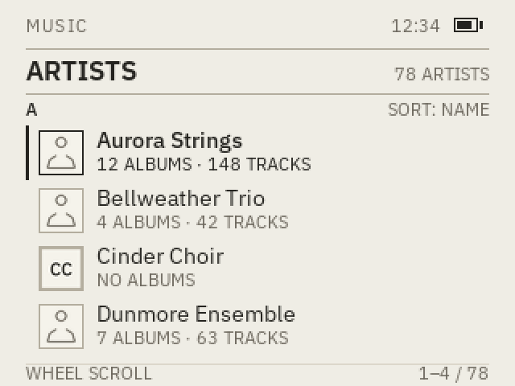
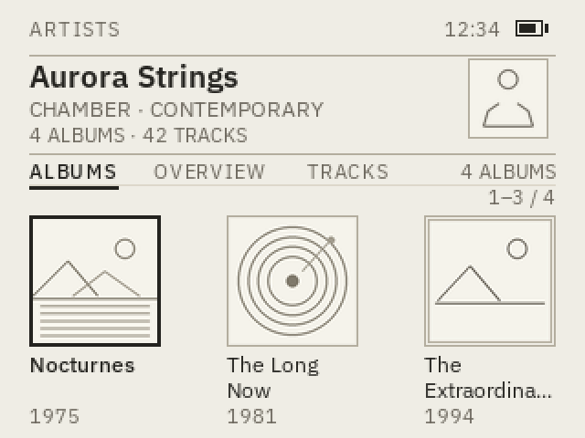
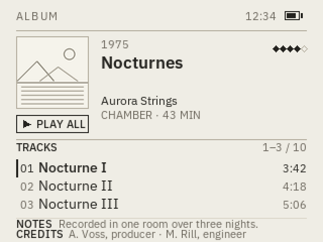

# UI design — default theme and typography

> Purpose: the first-party Helikon-OS UI look and the default typography scale.
> Status: living document; typography owner-settled; cleaned Music-flow and Now
> Playing binding design with host mockups; launcher renderer implemented on
> host; 6G panel run pending.
> Owner: project owner; UI lead
> Last updated: 2026-11-08
> Source: owner-supplied typography table, 2026-11-03; owner home-screen brief,
> 2026-11-05; owner Music-flow brief, 2026-11-08; design paper §14, §28.3.4;
> D-10, D-15, D-23, D-24; artist-view design-gate audit, 2026-11-06; `main`
> `2420c64`

This is the default first-party UI. It is not a skin format and not a promise
that a Rockbox WPS theme will render identically. Skins follow D-10 and D-15;
they may not make the first-party UI unusable.

## 1. Default typography

The iPod Classic 6G screen is 320×240. These values are for the default theme
at 1× scale.

| Element | Typeface | Size |
|---|---|---|
| Main menu | IBM Plex Sans Regular | 14 px |
| Selected item | IBM Plex Sans Medium | 14 px |
| Screen titles | IBM Plex Sans Semibold | 17 px |
| Artist / album | IBM Plex Sans Regular | 12 px |
| System information | IBM Plex Sans Regular | 11 px |
| Helikon-OS logo | Manrope Bold | Variable |

Weight mapping:

- IBM Plex Sans Regular = 400
- IBM Plex Sans Medium = 500
- IBM Plex Sans Semibold = 600
- Manrope Bold = 700 on the variable weight axis

`Variabel` in the owner table is recorded as “variable font / layout-dependent
logo size”. Confirm whether it means the variable font, a variable logo size, or
both. The logo is a wordmark, not a UI text style.

## 2. Rules

- IBM Plex Sans is the single UI family. Do not add a second UI family without an
  owner decision.
- UI text and icons use grayscale anti-aliasing. Precompute glyph masks or a
  glyph atlas; do not rasterize a full font per frame. Keep a readable 1-bit
  bitmap fallback if a font fails to load.
- Anti-aliased output must be checked on the 6G panel for contrast and clipping,
  not only on the host.
- Manrope Bold is only for the Helikon-OS logo/wordmark. It is not body, menu or
  title text.
- The selected item uses Medium at the same 14 px size as the main menu. The
  selection must be visible by weight/contrast, not by a size jump.
- Screen titles are 17 px Semibold. They are the largest UI text unless the logo
  is on screen.
- Artist/album metadata is 12 px. System information is 11 px.
- 11 px is the minimum for this default scale. Text must not clip, overlap or
  require horizontal scrolling. A large-text option remains an accessibility
  requirement.
- If a font fails to load or a glyph is missing, fall back to a readable system
  bitmap font and report the failure; the UI must remain usable. Do not silently
  substitute a proprietary font.
- The first-party UI must remain usable if a skin fails or is rejected.

## 3. Font assets and licensing

- IBM Plex Sans and Manrope are published under the SIL Open Font License.
  The licensed subsets, OFL texts, upstream sources and hashes are recorded in
  [`../assets/fonts/README.md`](../assets/fonts/README.md).
- `HelikonUI-Sans.ttf` is a renamed Latin-1 subset with the variable weight axis
  (Regular 400, Medium 500, Semibold 600). `HelikonWordmark.ttf` is a Manrope
  subset for `HELIKON-OS` at weight 700. Do not bundle the full upstream
  families; regenerate a subset only with a measured glyph list.
- The subsets are renamed because IBM Plex has a Reserved Font Name. Keep the
  OFL texts and copyright notices with the files.
- The owner-supplied mountain logo reference has an open licence/source; see
  `assets/logo/README.md`. The Manrope wordmark font is separate from that image.
- Do not copy proprietary themes, artwork, fonts or metadata.

## 4. Bootloader splash

The bootloader splash is the owner's final **green/red Alpha artwork**, not the
earlier 1-bit image. The source PNGs, the 16-colour 4bpp device representation,
the HFS+ label mask and the `#00BF63`/`#FE3131`/`#6B665C` label colours are
recorded in [`../assets/bootloader/README.md`](../assets/bootloader/README.md).
The final-splash image `6bc6927c…` was device-checked on one 6G/iFlash SD at
6.5 s startup with a clean `fsck_hfs -fn`.

The firmware first frame should continue this identity: off-white `#EFEDE5`
background, the same wordmark and type scale, and no contradictory HFS+ state.
The intended handoff is described in
[`firmware-architecture.md`](firmware-architecture.md) §9.10; it is a design
intent, not a firmware result. Do not replace the splash or the reference image
without owner approval.

## 5. Home and album-browser concepts (proposed)

> Status: owner-requested concept set; host mockups only. No renderer, 6G panel
> run or support claim. The owner will choose a home concept. The album wall is
> the album browser, not a home candidate.

The home screen has no playback element. Earlier attempts failed because a
now-playing hero or strip made the surface read as Now Playing. These concepts
keep home as a launch or index surface; playback is a separate screen. The album
wall is the one exception in role: it is the album browser, not a home.

All three use the same paper/ink palette, 1 px rules and Benguiat headers. All
names, counts and durations are sample content, not device data.

### 5.1 Palette (proposed)

| Token | Value | Use | Contrast on paper |
|---|---|---|---|
| Paper | `#EFEDE5` | page ground | — |
| Paper light | `#F5F3EB` | cover art ground | — |
| Ink | `#24231F` | primary text, selected marks, rules | 13.4:1 |
| Muted | `#6B665C` | secondary text, counts, descriptions | 4.9:1 |
| Rule | `#B3AD9E` | frames, hairlines, separators | 1.9:1 (decorative) |
| Faint | `#DCD7CA` | leader rules and inner detail | decorative |
| Live green | `#00BF63` | reserved for system status; not used here | 2.1:1 (non-text) |
| Error red | `#FE3131` | reserved for error screens | not used here |

The page stays off-white. Colour appears only in the six launcher icon accents;
the index and album wall remain monochrome. Green is a non-text status accent
and is deliberately absent from these three surfaces: none of them claims
playback or HFS+ state. Red never appears on a healthy screen.

#### Launcher accents (proposed)

| Icon | Accent | Contrast on paper |
|---|---|---|
| Music | `#9C3F2C` | 5.7:1 |
| Podcasts | `#31536B` | 6.9:1 |
| Audiobooks | `#8A6420` | 4.6:1 |
| Playlists | `#486346` | 5.7:1 |
| Games | `#64364C` | 8.2:1 |
| Settings | `#2D5F58` | 6.2:1 |

The accents are icon-line colours, not text colours. Secondary icon lines use a
58% paper mix of the same accent. No fill or wash is used behind the icons; the
page ground remains `#EFEDE5`. The divider mountain crest is ink, not an accent.

### 5.2 Concept A — phone-style launcher


A ceremonial but conventional home screen: a status folio, a larger centred
Benguiat masthead, and six frameless coloured line-icon cells. It has no
now-playing element, no content cards and no footer.

| Region | Frame (x, y, w, h) | Content |
|---|---|---|
| Top folio | 20, 8, 280, 10 | edition mark, centred diamond, time, battery |
| Masthead | 20, 26, 280, 30 | 26 px Benguiat wordmark, raised 4 px; divider unchanged |
| Divider | 40, 50, 240, 12 | two 2 px rules with end diamonds, flanking a small mountain crest |
| Grid | 24, 64, 272, 164 | two rows by three 64 px icon cells |
| Icon cell | 64 × 64 | frameless, 40 px coloured icon on a 24 px accent plinth; selected cell has an apex diamond and a 2 px label underline |
| Label | 78 × 14 below cell | 13 px Benguiat, centred |

Cells sit at x = 24, 128, 232 and y = 64, 150. The labels are `Music`,
`Podcasts`, `Audiobooks`, `Playlists`, `Games` and `Settings`. Focus runs
row-major: Music → Podcasts → Audiobooks → Playlists → Games → Settings.

The full-width rule is gone: two wider 2 px rules with small end diamonds now
flank a mountain crest under the wordmark. The wordmark sits 4 px higher; the
divider and crest did not move. The arches were removed rather than re-shaped
again; the grid is frameless. Each icon rests on a short accent plinth, and the
selected cell is marked by a small apex diamond and a 2 px underline beneath its
label.

This is the most literal “home screen” reading. It is a launcher: the six
cells are the only decisions on the surface. It does not show what is playing.
The Music cell opens the Music hub; the album wall and the cleaned Artists and
Tracks lists are its views.

#### Firmware launcher renderer (implemented on host)

`firmware/ui/launcher.c` composes the launcher from precomputed RGB565 tiles;
`tools/make-launcher-assets.py` generates them, the Music hub cells and the
Music wall headers from the same `tools/render-ui-mockup.py` icon and layout
code. The HELIKON-OS wordmark is
rasterized from the owner-supplied ITC Benguiat Medium face at the owner's
direction; the `.otf` is not committed. Labels use the tracked IBM Plex Sans
fallback. The folio, wordmark, divider, six icons and six labels are opaque
tiles. The accent plinths, the selected cell's apex diamond and the 2 px label
underline are drawn at runtime.

The wheel and left/right move the focus row-major through the six cells with
wrap. SELECT or PLAY on Music opens the Music hub; the other cells open labelled
placeholder screens. MENU on the launcher exits. The diagnostic image
powers off after 60 s idle. The input driver clears the wheel interrupt latch
before reading the status. The launcher build attaches to the loader's
already-initialized PMU, backlight and panel instead of resetting them, so the
loader splash stays lit until the first home frame. Buttons are edge-triggered
and the wheel requires four clicks per move with a 120 ms gate, so one press
or scroll notch moves one cell. The first firmware frame is the launcher; no
debug stage list appears.

```sh
make -C firmware BOARD=6g VERSION=10 BOOTSTATE_STATE=good UI=1 \
  EXTRA_CFLAGS='-DHELIKON_DIAG_LAUNCHER' \
  BUILD=../build/firmware/6g-launcher image
```

The image stops after the LCD stage and does not touch storage.
`make -C tests/ui preview` renders the real firmware buffer to
`build/ui/launcher.png` and checks the focus marks, icon presence and
framebuffer bounds. No 6G panel run yet.

#### Music hub and library walls (functional test)

`firmware/ui/music.c` is the first functional Music section. The launcher's
Music cell opens a launcher-style hub with three cells: Albums, Artists and
Tracks. Albums and Artists use the album-wall geometry from
`assets/ui/album-wall`: a 4×3 wall of 52 px frames with 46 px art, Benguiat
headers, counts, a selected caption and a position. Artist entries without a
profile picture use a monogram. Tracks is the title-index list. The wheel or
left/right moves, SELECT opens and MENU returns one level; album, artist and
track pages reuse the same header language. Artwork is 96×96 RGB565 scaled
96→46 with nearest-neighbour sampling on the wall. The search mark is present
but has no action yet.

The build uses the 3×5 fallback font for dynamic text until the Plex atlas
(T-042/T-057). The first audio build adds a Now Playing progress view for the
embedded WAV track; other tracks state that playback is next.

For the pre-VFS test, the signed image embeds a 100-song HelikonDB:

```sh
make -C firmware BOARD=6g VERSION=14 BOOTSTATE_STATE=good UI=1 \
  HDB=../build/helikondb/first100/music.hdb \
  EXTRA_CFLAGS='-DHELIKON_DIAG_LAUNCHER' \
  BUILD=../build/firmware/6g-music image
```

It touches no storage and no ATA. `make -C tests/ui preview` renders
`build/ui/music-hub.png`, `music-albums.png`, `music-artists.png`,
`music-tracks.png`, `music-artist.png`, `music-artist-albums.png`,
`music-artist-tracks.png`, `music-album.png` and `music-track.png` from the
fixture catalog.

#### First audio path (implemented on host, device pending)

`firmware/hal/6g/audio.c` initializes the CS42L55, I2S and PL080 DMA;
`firmware/player/` parses 16-bit PCM WAV at 44.1/48 kHz and plays bounded
chunks. The track page for `AUDIO_TRACK` opens a Now Playing view with a
progress bar, `PLAYING`/`PAUSED`, time, and PLAY pause/MENU stop controls.
Other tracks retain the “playback coming next” state. The WAV is local, not
committed; see [`audio-formats.md`](audio-formats.md) §11 for the build command.
`tests/ui` renders `audio-now-playing.png` and `audio-paused.png`; the WAV
parser and player state are in `tests/player`. No 6G audio run yet.

### 5.3 Concept B — neoclassical index


A typographic contents page: wordmark, four numbered sections and a printer’s
hourglass. It has no icons, no cards and no playback.

| Region | Frame (x, y, w, h) | Content |
|---|---|---|
| Masthead | 20, 8, 280, 32 | 22 px Benguiat wordmark, time, battery |
| Index rows | 20, 50, 280, 160 | four rows, 40 px each |
| Row | 280 × 40 | Roman numeral, 20 px Benguiat section, 11 px description, right count |
| Colophon | 155, 218, 10, 16 | centred hourglass |

The sections are:

| Numeral | Section | Description | Count |
|---|---|---|---|
| I | LISTEN | Music · Podcasts · Audiobooks | 1,284 |
| II | BROWSE | Artists · Albums · Genres | 86 |
| III | PLAY | Playlists · Games | 9 |
| IV | SETTINGS | Display · System · About | — |

“BROWSE” is used instead of “READ” because audiobooks and podcasts are audio.
The owner can rename the sections without changing the layout.

The selected row gets an ink tab behind its numeral and section name. The
description and count stay below the tab in ink. The tab is the only dark block
on the screen; there is no row-height change and no icon.

This is the calmest and most distinctive surface. It is an index, not a
dashboard: four large rooms and no content previews. BROWSE is the natural entry
to the album wall.

### 5.4 Concept C — content walls (album, podcast, audiobook browsers)

The three walls are browsers, not home-screen candidates. The owner asked for
the music album wall first and then matching podcast and audiobook walls.


They share one layout:

| Region | Frame (x, y, w, h) | Content |
|---|---|---|
| Header | 29, 8, 262, 28 | 18 px Benguiat title, count, search icon |
| Wall | 29, 44, 262, 172 | four columns by three rows of 52 px covers |
| Caption | 29, 220, 262, 16 | focused item and position |

| Wall | Header | Count | Caption sample | Status |
|---|---|---|---:|---|
| Album | `ALBUMS` | 86 | Nocturnes · Helikon Trio | — |
| Podcast | `PODCASTS` | 18 | The Long Now · Ep. 42 · 3 new | green dot on new-show covers |
| Audiobook | `AUDIOBOOKS` | 48 | The Long Now · M. Voss · 12h 40m · 34% | — |

Covers sit at x = 29, 99, 169, 239 and y = 44, 104, 164. The selected cover gets
a 2 px ink frame; the caption updates to its item. The search icon in the header
is a focus stop and opens search. Each wall scrolls vertically; the count and the
`1 / N` caption show position. None has a playback bar.

The podcast wall uses the splash green `#00BF63` only as a small new-episode dot.
The audiobook caption includes author, duration and reading progress; the
percentage is not playback. The walls are intentionally denser than either home
concept: browsing cover art benefits from more covers per screen. They are not a
model for the home layout.

The album wall is reached from BROWSE; the podcast wall from Podcasts; the
audiobook wall from Audiobooks. The hardware Menu button returns to the previous
screen.

### 5.5 Headers and type

- ITC Benguiat Std is the display face for every wordmark and header on these
  screens: launcher wordmark 26 px Medium; launcher labels 13 px Book; index
  wordmark 22 px Medium; index section names 20 px Book; index numerals 12 px
  Book; album-wall title 18 px Book.
- IBM Plex Sans is the body face: 12 px for album and track titles; 11 px for
  descriptions, counts, captions and time. The 11 px minimum is unchanged.
- These home surfaces do not use the 14 px selected-row rule from D-23. That
  rule remains for list screens. Selection here is an apex diamond plus a 2 px
  label underline (launcher), a 2 px cover frame (album wall) or an ink tab
  (index), never a size change.
- The launcher icons use the six muted accents in §5.1. No fill or wash sits
  behind them; secondary icon lines are a lighter wash of the accent, and each
  icon sits on a 24 px plinth at a 50% paper mix. Labels stay ink and the page
  stays paper.
- D-52 records the proposed exception to D-23. D-23 currently accepts IBM Plex
  Sans as the single UI family; these concepts use Benguiat because the owner
  directed it. Until D-52 is accepted, they are proposals, not settled defaults.
- Licensing: ITC Benguiat is proprietary Monotype font software. The owner
  supplied the `.otf` files locally. They are not committed, redistributed or
  extracted from the rendered mockups. `BENGUIAT_DIR` must point to the owner’s
  folder; another machine cannot regenerate the screens without it.
- If the firmware cannot ship Benguiat, the fallback is a tracked IBM Plex Sans
  Semibold treatment, not another proprietary face and not a silent
  substitution.
- The splash title is owner bitmap artwork in Benguiat. These headers continue
  that display voice; the transition from splash to home is a content change,
  not a typeface change.

### 5.6 Focus and states

- Launcher: a focused cell gets a small apex diamond and a 2 px underline
  beneath its label. The icon and label do not grow or move. Focus is row-major
  and wraps.
- Index: a focused row gets the ink tab behind its numeral and name; the
  description and count change from muted to ink. No row-height change.
- Album wall: a focused cover gets a 2 px ink frame; the caption updates. The
  search icon is reachable from the wall and opens search.
- None of the three shows a playback state. There is no green dot, progress bar
  or now-playing strip on a home concept. If the owner later wants a playback
  cue, it must be a small status mark, not a strip or hero.
- The album wall may show an empty state (“No albums”) and a search-empty state;
  the home concepts show their sections even when a section is empty, with a
  muted count.
- A read-only HFS+ volume is explained in System Info; none of these screens
  paints an HFS+ claim. Red is reserved for error screens.
- Large text: the launcher becomes a two-column paged grid; the index drops to
  two rows per page; the album wall becomes three columns. No clipping or
  horizontal scrolling. This remains T-074 work.

### 5.7 Motion and rendering

- Focus changes are instant; no sliding highlight, parallax or shadow.
- Rules and frames are 1 px; text and icons use grayscale anti-aliasing with the
  1-bit fallback from D-24.
- Launcher icons are 40 px line art in the six accent colours, centred by
  ink bounds inside 64 px frameless cells and resting on 24 px accent plinths.
  There is no arch or fill; focus is the apex diamond and label underline.
  Album-wall covers are 46 px art inside 52 px frames. The index has no bitmap
  artwork.
- The album wall scrolls; the two home concepts are static.
- Content is read before the frame is drawn; no per-frame library query.

### 5.8 Open questions

- Which home concept does the owner choose: launcher, index, or a hybrid?
- Does “BROWSE” stay, or should the index use “READ” as originally sketched?
- D-52 scope: home headers only, or all first-party headers? Does the wordmark
  change globally?
- Can ITC Benguiat be embedded in firmware, or must headers be pre-rendered
  bitmaps/atlases under the font licence?
- Are the six launcher icons the right set, and do the line drawings read on the
  6G panel?
- Are the three walls dense enough for searching, or should they use 3 × 2
  with larger covers?
- Should the three walls share one search, sort and filter model?
- Do the six icon accents hold on the 6G panel, or should the launcher use one
  accent plus ink?
- Does the frameless icon grid hold on the 6G panel, or does it need a quiet
  cell frame?
- 11 px captions, 13 px labels and 20 px index names on the 6G panel, not only
  on the host.
- Large-text and high-contrast layouts.

## 6. Music flow — Artists, Artist, Album and Now Playing (binding design)

> Status: binding design specification for the cleaned T-088 Music flow and the
> T-058/F5 Now Playing surface. Host mockups only: no firmware change, no 6G
> panel run, no playback claim and no support claim. The earlier album/artist
> mockups are superseded; they are recorded as history in §6.13.
> Owner: UI lead. Last updated: 2026-11-08.
> Source: owner Music-flow brief, 2026-11-08; D-23, D-24, D-15; artist-view
> design-gate audit, 2026-11-06; `main` `2420c64`; [`audio-formats.md`](audio-formats.md)
> §11; `firmware/player/wav.h` and `firmware/hal/6g/audio.h`.

**Binding** means an implementation PR must match this section or record an
owner-approved deviation in `docs/decisions.md`. It does not make a device,
format-support or playback claim. Items marked **proposed** are not settled
product decisions.

D-52 is proposed and is scoped to home headers. This flow is **IBM Plex Sans
only**: 11/12/14/17 px at the D-23 weights. No ITC Benguiat glyph is used or
required, so the licensing question does not block this flow. A future accepted
D-52 could restyle the 17 px titles as display headers without changing the
frames; that is proposed and not part of this gate.

### 6.1 Binding and proposed items

**Binding**

- The screen order, default tab and focus model in §6.2 and §6.4–§6.7.
- The frame maps, 16 px side margins, 1 px rules, 2 px focus marks and the
  320×240 canvas.
- The D-23 type roles, 11 px floor, mixed case and visible U+2026 truncation.
- The paper/ink palette; no cards, shadows, gradients, sidebar or player bar.
- Plex-only typography; no Benguiat, no 3×5 fallback and no second UI family.
- No dead controls: every drawn action is reachable and performs its label.
- Album tracks inline; no separate track-selection screen.
- Now Playing state set, error reason slot, honest sound-quality fields and a
  bounded 12-bar sample-peak visualizer with reduced/off fallback.
- The design-gate checklist in §6.11.

**Proposed**

- Sample names, counts, biographies, notes and durations in the mockups. They
  are illustrative content, not device data.
- One-line notes/credits excerpts on the Album page. Whether full notes/credits
  get a later reading surface is open.
- The exact retryable/terminal mapping of the firmware audio stages. F5 owns the
  final mapping; this section fixes the slot and the visible copy.
- `PLAY ALL` skipping unreadable tracks. The visible behaviour is defined; the
  player implementation is not.
- Visualizer target numbers. They are budgets to measure, not measurements.
- Artist portrait art: generated line art in the mockups; a real artist image
  may replace it at the same frame, but that is not part of this gate.
- A future D-52 display-header restyle.

**Out of scope**

- Launcher and Music hub redesign. They are not part of this specification.
- Firmware, player, audio HAL, bootloader and companion edits.
- Device evidence, font-atlas implementation, theme format and skin support.

### 6.2 Screen map and flow

The Music section is a browse-and-play flow, not a set of independent tabs. The
album is the unit of intent; the track list lives inside it; Now Playing is the
transport surface.

| From | Action | To |
|---|---|---|
| Music hub (out of scope) | Select Artists | Artists list |
| Artists list | Select an artist | Artist view, `ALBUMS` tab |
| Artist view | Select an album | Album view |
| Artist view | Switch to `OVERVIEW` | Artist overview; biography below the album shelf, never before it |
| Artist view | Switch to `TRACKS` | Artist top tracks |
| Album view | Select a track | Now Playing, that track |
| Album view | Select `PLAY ALL` | Now Playing, first playable track |
| Now Playing | Menu | Previous screen (album or artist view) |
| Now Playing | Select album identity, when resolvable | Album view |
| Now Playing | Play | Pause/resume; replay at `FINISHED` |

There is **no separate track-selection screen**. The album page owns the
cover, identity, rating, notes/credits excerpts and the inline track list.
Opening a second list would duplicate the album identity, add a back-stack
level and make the 6G interaction slower for the primary task.

**Hub boundary.** The launcher and Music hub are out of scope and are not
redesigned. The hub's existing `Artists` entry opens this Artists list; the old
4×3 artist wall is superseded for artist browsing. The hub's `Albums` entry may
keep the existing album wall (also out of scope) and open this Album view from
it. The hub's `Tracks` entry is unchanged. If the hub must keep the artist wall
instead, the list must become the wall's first-level view; that routing choice
is an open question, not a reason to change the hub cells.

The Artist view defaults to `ALBUMS`. Tabs are ordered `ALBUMS`, `OVERVIEW`,
`TRACKS`. The biography cannot be the first content on the artist page.

### 6.3 Shared frame, typography and palette

Canvas: 320×240 RGB565. Side margins: 16 px; content column: 288 px. The top bar
is chrome, not a playback claim.

| Region | Frame (x, y, w, h) | Rule |
|---|---|---|
| Top bar | 16, 8, 288, 18 | 11 px label at baseline 20; time right-aligned to 274; battery at 282, 11, 18, 9 |
| Top rule | 16, 30, 288, 1 | Rule `#B3AD9E` |
| Footer rule | 16, 226, 288, 1 | Faint `#DCD7CA`, only where a footer exists |
| Footer text | 16, 236 | 11 px Regular, muted |

Type roles (D-23 sizes; no other size is used in this flow):

| Role | Face | Size / weight | Line height | Tracking |
|---|---|---|---:|---:|
| Screen/content title | IBM Plex Sans | 17 px / 600 | 20 | 0 |
| List row, track title | IBM Plex Sans | 14 px / 400 | 18 | 0 |
| Selected row, state label | IBM Plex Sans | 14 px / 500 | 18 | 0 |
| Artist, album, biography, notes/credits, error reason | IBM Plex Sans | 12 px / 400 | 16 | 0 |
| Metadata, counts, time, footer, top label | IBM Plex Sans | 11 px / 400 | 14 | 0 |
| Section/tab/short label | IBM Plex Sans | 11 px / 500 | 14 | 0 |

Rules:

- 11 px is the floor. There is no 10 px, 5 px or 3×5 text. Do not shrink a
  string to fit; use the defined line count and U+2026.
- Body text preserves source case. Only labels and state words are uppercase:
  `MUSIC`, `ARTISTS`, `ARTIST`, `ALBUM`, `NOW PLAYING`, `ALBUMS`, `OVERVIEW`,
  `TRACKS`, `PLAY ALL`, `PLAYING`, `PAUSED`, `OPENING`, `FINISHED`,
  `AUDIO PLAYBACK FAILED`.
- Titles: 17 px Semibold, at most two lines in Artist, Album and Now Playing;
  one line in Artists list and track rows. The last visible line ends with
  U+2026 at a word boundary where one exists. Never cut silently and never
  scroll horizontally.
- Row selection uses weight/contrast and a 2 px ink bar/frame, never a size
  jump. Focus is visible without colour alone.
- Line heights above are binding for this flow. They do not settle line height
  for unrelated screens.

Palette:

| Token | Value | Use in this flow | Contrast |
|---|---|---|---|
| Paper | `#EFEDE5` | page ground | — |
| Paper light | `#F5F3EB` | generated art ground, monogram ground | — |
| Ink | `#24231F` | titles, primary text, rules, focus marks, progress fill | 13.4:1 |
| Muted | `#6B665C` | counts, genre, album, notes/credits, footer, error guidance | 4.9:1 |
| Rule | `#B3AD9E` | hairlines, frame outlines, art frame | 1.9:1 decorative |
| Faint | `#DCD7CA` | secondary rules and baselines | decorative |
| Error red | `#FE3131` | 2 px error status rule only; never text | 3.1:1 non-text |

No green is used in this flow. Playing is not a system-health claim. There are no
cards, shadow, gradient, wash, sidebar or player bar. The only filled areas are
the focus bar, the focused `PLAY ALL` plate, the progress fill and the
visualizer bars. Generated art is paper-light line art, not real cover art.

### 6.4 Artists list



| Region | Frame (x, y, w, h) | Content |
|---|---|---|
| Top bar | 16, 8, 288, 18 | `MUSIC`; time, battery; rule at 30 |
| Title | 16, 34, 220, 22 | `ARTISTS` 17 Semibold; count `78 ARTISTS` right at 304 |
| Title rule | 16, 58, 288, 1 | Rule |
| Section header | 16, 60, 288, 14 | current letter 11 Medium; `SORT: NAME` right at 304 |
| Rows | 16, 78 + n×36, 288, 34 | four visible rows |
| Art | 24, y+3, 28, 28 | artist image or 2-letter monogram; 1 px frame |
| Name | 60, y+2, 244, 16 | 14 px; one line; ellipsis; selected uses Medium |
| Counts | 60, y+16, 244, 14 | 11 px `N ALBUMS · M TRACKS`; muted unless selected |
| Footer | 16, 226, 288, 14 | `WHEEL SCROLL` left; `1–4 / 78` right |

The Artists list is a browser list, not a home screen: it has no playback
element, launch tiles, hero art or dashboard modules.

**Sorting and grouping.** Use the HelikonDB artist table order (sort name).
Group by the first collation letter of the sort name; the section header is
sticky while that group is visible. Non-Latin names go in a `#` group. The
header is not focusable and does not consume a row when pinned.

**Art.** Scale the 96×96 artist image to 28×28 with nearest-neighbour sampling.
If it is missing, draw a two-letter monogram from the name in 11 px Medium on
paper-light with a 1 px rule. Never show a broken-image icon, a blank square or
a fabricated photograph. If the name is empty, show `UNKNOWN ARTIST` and `?`.

**Counts.** `1 ALBUM` is singular. Zero albums shows `NO ALBUMS`. Missing or
unreadable counts show `COUNTS UNAVAILABLE`; do not invent numbers. Track count
is omitted when the album count is zero.

**Focus and input.** Wheel up/down moves one row, clamped at the ends (no wrap).
The selected row gets a 2 px ink bar at x=16, a 14 px Medium name and ink
counts. The row does not grow, move or change colour. SELECT opens the artist;
PLAY has no list action and is not shown; MENU returns. When the selection
leaves the four-row window, the list scrolls by one row; the section header
stays pinned and the footer range updates.

**Long names.** One line at 14 px from x=60 to 304; truncate with U+2026. Do not
wrap a row or reduce the type size. The mockup `artists-long` shows the selected
long name and a missing-art monogram.

**States.** Normal: art, monogram, counts, zero albums. Missing data: monogram,
`NO ALBUMS`, `COUNTS UNAVAILABLE`. Empty list: `NO ARTISTS IN LIBRARY` in the
row area and `0 / 0` in the footer; no fabricated rows.

### 6.5 Artist view



| Region | Frame (x, y, w, h) | Content |
|---|---|---|
| Top bar | 16, 8, 288, 18 | `ARTISTS`; time, battery; rule at 30 |
| Portrait | 256, 32, 44, 44 | 42 px generated portrait or monogram; 1 px frame |
| Name | 16, 32, 228, 20 | 17 Semibold; one line, ellipsis |
| Genre | 16, 48, 228, 18 | 12 px muted; one line, ellipsis |
| Counts | 16, 64, 228, 16 | 11 px muted `N ALBUMS · M TRACKS` |
| Identity rule | 16, 84, 288, 1 | Rule |
| Tabs | 16, 86, 288, 14 | `ALBUMS`, `OVERVIEW`, `TRACKS` at x=16, 84, 168 |
| Tab rule | 16, 101, 288, 1 | Faint; selected 2 px ink underline at y=102 |
| Album count | 214, 86, 90, 14 | 11 px muted; right-aligned to 304 |
| Body | 16, 108, 288, 128 | tab content |

Tabs are ordered `ALBUMS`, `OVERVIEW`, `TRACKS`; `ALBUMS` is the default. The
tab labels are 11 px; selected is Medium + 2 px underline; unselected is
Regular muted. The album count stays right-aligned. The body never starts with
biography.

**ALBUMS (default).** Position `1–3 / N` at 304, 112. Three 72×72 cells at
x=16, 124, 232, y=118. Art is 68×68 inside a 1 px rule; selected has a 2 px ink
frame. Caption: album title 12 px, up to two lines at baselines 204 and 218;
year 11 px at 232. Long titles ellipsize. Missing art uses the generated
paper-light sleeve placeholder; no broken image.

Wheel left/right moves the album selection; the shelf pages by three when the
selection crosses a page edge. SELECT opens the focused album. PLAY has no
artist-level action and no `PLAY` plate; do not add a dead control. MENU
returns. Empty: `NO ALBUMS IN LIBRARY` at 128, position `0 / 0`, no cells.

**OVERVIEW.** Biography: 12 px, max four lines, baselines 122/138/154/170. If a
biography exists, show it, then a 1 px rule at 182, `N ALBUMS · M TRACKS` at
198, and derived `FIRST <title> (<year>)` / `LATEST <title> (<year>)` at 212 and
226. These are catalog facts, not a claim about formation, origin or city. If
there is no biography, show `NO BIOGRAPHY AVAILABLE` at 122. If there are no
derived facts, show `NO CATALOG FACTS` at 138 and do not draw the rule. There
are no formed/origin fields in HDB v1; do not display them.

**TRACKS.** Position `1–4 / N` at 304, 112. Four rows at 28 px pitch from 118:
title 14 px at y+12, album context 11 px muted at y+24, duration 11 px right at
y+12. Selected row: 2 px ink bar 26 px tall, title Medium. SELECT starts the
track and opens Now Playing; PLAY follows the global pause/resume rule. Missing
tracks: `NO TRACKS IN ARTIST` at 122 and position `0 / 0`.

### 6.6 Album view — one page, inline track list



| Region | Frame (x, y, w, h) | Content |
|---|---|---|
| Top bar | 16, 8, 288, 18 | `ALBUM`; time, battery; rule at 30 |
| Cover | 16, 36, 72, 72 | 70 px art or placeholder; 1 px rule |
| Album action | 16, 114, 72, 18 | `PLAY ALL` 11 Medium; outline unfocused, ink fill focused |
| Year | 100, 36, 80, 14 | 11 px muted; `YEAR —` when missing |
| Rating | 270, 42, 34, 12 | five 6 px diamonds; filled by `round(rating/20)`; all outline when unrated |
| Title | 100, 54, 204, 44 | 17 Semibold, max two lines, width 204, ellipsis |
| Artist | 100, 90, 204, 16 | 12 px, one line, ellipsis |
| Genre/length | 100, 104, 204, 14 | 11 px muted; omit missing values honestly |
| Body rule | 16, 138, 288, 1 | Rule |
| Tracks label | 16, 140, 100, 14 | `TRACKS` 11 Medium |
| Track position | 224, 140, 80, 14 | `1–3 / N`; `0 / 0` when empty |
| Track rows | 16, 158 + n×18, 288, 18 | three visible rows |
| Colophon rule | 16, 216, 288, 1 | Faint |
| Notes label | 16, 226, 40, 14 | `NOTES` 11 Medium ink |
| Notes excerpt | 58, 226, 246, 14 | 11 px muted, one line, ellipsis; omit if unavailable |
| Credits label | 16, 236, 50, 14 | `CREDITS` 11 Medium ink |
| Credits excerpt | 68, 236, 236, 14 | 11 px muted, one line, ellipsis; omit if unavailable |

**Why inline.** The album is the object the user chose; the tracks are its
contents. A separate track-selection screen duplicates the cover, title and
artist, adds a back-stack level and forces a second open. Inline keeps the
album identity visible while choosing a track, matches the one-page reading
model and keeps the primary task one SELECT away. The 3-row window scrolls;
the identity and `PLAY ALL` stay fixed.

Notes and credits are optional editorial sidecar data. HDB v1 has no
notes/credits fields, so the page shows one-line excerpts only when the local
sidecar provides them; if it does not, omit the lines and do not fabricate
copy. A full notes/credits reading surface remains an open question. Year,
genre and rating come from the HDB album record; a missing year shows `YEAR —`,
a missing genre is omitted, and an unrated album shows five outline diamonds.

Track rows come from the album's contiguous HDB track slice. Durations are
formatted from `duration_ms`; an unreadable row shows `TRACK DATA MISSING` and
is not focusable. The track number is the HDB track number within its disc; a
multi-disc album shows a `DISC n` label when the disc count is greater than one.

**Actions.**

- `PLAY ALL`: starts the album at the first playable track and opens Now
  Playing. It is a focus stop; outline unfocused, ink fill focused. Hidden when
  the album has no playable track. It never appears as a dead plate.
- Track SELECT: starts the focused track and opens Now Playing.
- Track PLAY: PLAY is the global transport key. It pauses/resumes the current
  stream without leaving the album; if no stream exists, it starts the focused
  track and opens Now Playing.
- Corrupt/unreadable rows are visible, muted, skipped by focus and `PLAY ALL`,
  and never start playback. If every track is unreadable, hide `PLAY ALL` and
  show `NO PLAYABLE TRACKS` in the track area.
- No shuffle, repeat, queue, volume, seek or overflow controls are shown; the
  current firmware supports none of them on this surface.
- MENU returns to the Artist view.

**Focus.** The initial focus is track 1 (2 px bar, 14 Medium). Wheel up from
track 1 reaches `PLAY ALL`; wheel down moves through the playable tracks. The
focused `PLAY ALL` plate is filled ink with paper text; the unfocused plate is
outlined. No size change.

**Long title.** Two lines at 17 px, ellipsis on line 2; artist one line; genre
`—`; notes/credits omitted when unavailable; track titles one line with
ellipsis. Missing art uses the generated sleeve placeholder, not a broken image.

**Empty/corrupt.** Empty: `NO TRACKS IN ALBUM` at 168, `0 / 0`, `PLAY ALL`
hidden, notes/credits still shown if present. Corrupt: muted `TRACK DATA
MISSING` row, skipped; `1 TRACK UNREADABLE` at 226. If there are no notes or
credits at all, show `NO CREDITS LISTED` as a visible empty state; otherwise
omit an absent excerpt rather than inventing copy.

**Rating.** Five diamonds, 6 px each; filled = `round(rating/20)` clamped 0–5;
all outline and no text when unrated. The rating is metadata, not a playback or
quality claim.

### 6.7 Now Playing


| Region | Frame (x, y, w, h) | Content |
|---|---|---|
| Top bar | 16, 8, 288, 18 | `NOW PLAYING`; time, battery; rule at 30 |
| Cover | 16, 38, 96, 96 | 94 px art or generated placeholder; 1 px ink frame |
| Title | 124, 38, 180, 44 | 17 Semibold, max two lines, width 180, ellipsis |
| Artist | 124, 82, 180, 18 | 12 px; one line, ellipsis |
| Album | 124, 100, 180, 16 | 12 px muted; one line, ellipsis |
| Track line | 124, 116, 180, 14 | 11 px muted `TRACK n OF m · duration`, when known |
| State | 124, 132, 180, 18 | 14 Medium; icon then label; `OPENING`/`FINISHED` have no icon |
| Visualizer | 16, 140, 96, 16 | 12 sample-peak bars, baseline at 156 |
| Progress | 16, 166, 288, 4 | Rule track; ink fill |
| Time | 16, 172, 150, 14 | 11 px `elapsed / total`; `--:--` when unknown |
| Details rule | 16, 198, 288, 1 | Faint |
| Source quality | 16, 200, 288, 14 | 11 px muted |
| Output quality | 16, 214, 288, 14 | 11 px muted |
| Footer | 16, 226, 288, 14 | 11 px muted; only real actions |

The 96×96 cover matches the catalog artwork size. It is square, never stretched
or upscaled. Missing art uses a generated paper-light mountain/sun mark with a
1 px rule; it is not a broken-image icon and never blocks playback.

**Visualizer.** A 96×16 twelve-bar sample-peak meter sits under the cover at
(16, 140). Each bar is a peak from a 1024-frame window; the audio service keeps
12 peak bytes plus one release byte and the UI only reads them. There is no FFT,
no spectrum analysis, no sample copy and no allocation in the draw path. Update
at 10 Hz, draw at most 12 rectangles per update and 120 per second. Targets:
≤1% CPU, ≤256 B RAM and ≤1 ms per update on the 6G; these are budgets, not
measurements. Reduced mode draws four bars at 5 Hz; off mode draws only the
1 px faint baseline. `OPENING`, `FINISHED` and `ERROR` show the inactive
baseline; `PAUSED` keeps the last peaks frozen. The bars are ink, never a
rainbow, gradient or fake motion.

### 6.8 Now Playing states


| State | Visual signature | Progress/time | State line | Footer |
|---|---|---|---|---|
| `OPENING` | cover and known metadata | empty bar; `0:00 / --:--` | `OPENING`, no icon | `PLEASE WAIT` |
| `PLAYING` | normal cover | fill at position; `elapsed / total` | play triangle + `PLAYING` | `PLAY PAUSE · SELECT ALBUM · MENU BACK` |
| `PAUSED` | normal cover; no dimming | frozen fill and time | pause bars + `PAUSED` | `PLAY RESUME · SELECT ALBUM · MENU BACK` |
| `FINISHED` | normal cover | full bar; `total / total` | `FINISHED`, no icon | `PLAY REPLAY · SELECT ALBUM · MENU BACK` |
| `ERROR` retryable | red 2 px rule; no cover/progress/visualizer | `STOPPED AT <time>` | `AUDIO PLAYBACK FAILED` headline, reason, guidance, identity | `SELECT RETRY · MENU BACK` |
| `ERROR` terminal | same | `STOPPED AT 0:00` | same headline; specific reason | `SELECT ALBUM · MENU BACK` or `MENU BACK` |
| Missing art | placeholder in any normal state | as that state | as that state | as that state |
| Long metadata | two-line title/ellipsis; one-line artist/album/ellipsis | as that state | as that state | as that state |

State rules:

- `OPENING` is shown until the first audio frame is ready. It is a real state,
  not a modal. The current player open is synchronous and can block input for
  up to 2 s; the screen shows `PLEASE WAIT` and never claims `CANCEL` until the
  player services MENU during open. This is an implementation limitation, not
  a design claim.
- `PLAYING` updates progress at most once per second or on a state change. The
  progress fill follows the playback clock, not a UI tick.
- `PAUSED` freezes the fill and time; no dimming; PLAY resumes at the same
  position.
- `FINISHED` appears only when the play context has no next track. PLAY replays
  from 0:00; if the stream must reopen, show `OPENING`.
- `ERROR` has no cover, progress or visualizer. The red rule is the only red.
  The reason slot is one line, at most 44 characters at 12 px, with U+2026 if
  needed. The guidance is one line. A failed retry stays in `ERROR` with an
  updated reason; it never loops automatically.
- `SELECT ALBUM` appears only when the track resolves to an album. If it does
  not, omit it. Never draw a dead action.
- No shuffle, repeat, queue, volume, seek, next/previous or overflow controls
  are shown. The current player supports pause/resume and stop, not those
  actions.

### 6.9 Sound-quality data rules

Sound quality is a short, honest facts block, not a marketing claim.

- **Source line:** `<container> · <codec> · <bit depth> · <sample rate>`.
  Example: `WAV · PCM · 16-BIT · 44.1 kHz`.
- **Output line:** `<bitrate> kbps · OUT <rate> · <channels>`.
  Example: `1411 kbps · OUT 44.1 kHz · STEREO`.
- **PCM bitrate:** `sample_rate × channels × bits / 1000`; the 16-bit stereo
  44.1 kHz example is 1411 kbps. For compressed codecs, use the container's
  declared bitrate or the measured average; if the container is VBR and no
  average exists, show `VBR` and do not invent a number.
- **Source depth:** only show a bit depth for PCM or a codec that declares one.
  A compressed codec without a meaningful bit depth shows `—`.
- **Output rate:** read `struct helikon_audio.sample_rate` after the stream
  starts. If it differs from the source rate, show both as `SRC` and `OUT`. If
  it is unknown, show `OUT —`; do not claim bit-perfect or resampling.
- **Unavailable fields:** collapse each group to `—` rather than printing
  plausible-looking values. Examples: `SRC —` and `OUT —` during `OPENING` or
  after a device failure. Never show `0 kHz`, `0 kbps` or a guessed codec.
- **Current WAV path:** `WAV · PCM · 16-BIT · 44.1 kHz` or 48 kHz, mono or
  stereo; output equals the source rate because the current HAL sets the codec
  to the source rate. This is evidence from the player/audio headers, not a
  device measurement.
- **Future codecs:** the field contract is design-only until the codec framework
  and VFS provide the values. Missing decoder metadata is `—`, not a fallback
  label such as "lossless".

### 6.10 Error copy and the AUDIO stage slot

The error frame is:

1. a 2 px `#FE3131` rule at (16, 40, 288, 2);
2. `AUDIO PLAYBACK FAILED` 17 Semibold at baseline 68;
3. the reason at 12 px, baseline 92, one line, max 44 characters;
4. guidance at 12 px muted, baseline 114;
5. track identity 11 px muted, baseline 138;
6. 1 px faint rule at 150;
7. source quality 11 px at 164; `OUT — · PLAYBACK STOPPED` at 178;
8. `STOPPED AT <time> · TRACK n OF m` at 192;
9. footer at 232: `SELECT RETRY · MENU BACK` or `SELECT ALBUM · MENU BACK`.

The reason is a UI slot, not a fixed sentence. It must name the failing path.
The current `helikon_player_error_text()` strings are:

| Audio stage/error | Reason copy | Retryable (proposed) |
|---|---|---|
| `HELIKON_AUDIO_STAGE_CODEC` | `AUDIO CODEC/I2C` | no |
| `HELIKON_AUDIO_STAGE_RATE` | `AUDIO CODEC RATE` | no |
| `HELIKON_AUDIO_STAGE_I2S` | `AUDIO I2S/CLOCK` | no |
| `HELIKON_AUDIO_STAGE_DMA_SETUP` | `AUDIO DMA SETUP` | yes |
| `HELIKON_AUDIO_STAGE_DMA_WAIT` | `AUDIO DMA TIMEOUT` or `AUDIO DMA ERROR` | yes |
| `HELIKON_AUDIO_STAGE_DMA_ACTIVE` | `AUDIO DMA ACTIVE` | yes |
| `HELIKON_AUDIO_STAGE_CACHE` | `AUDIO CACHE` | yes |
| `HELIKON_AUDIO_STAGE_BUFFER` | `AUDIO BUFFER` | yes |
| `HELIKON_AUDIO_STAGE_DMA_CLOCK` | `AUDIO DMA CLOCK` | yes |
| `HELIKON_AUDIO_STAGE_DMA_CONFIG` | `AUDIO DMA CONFIG` | yes |
| `HELIKON_AUDIO_STAGE_I2S_FIFO` | `AUDIO I2S FIFO` | no |
| `HELIKON_AUDIO_STAGE_STREAM_UNDERRUN` | `AUDIO UNDERRUN` | yes |
| Player format/profile errors | `AUDIO WAV FORMAT`, `AUDIO WAV PROFILE` | no |
| Unknown | `AUDIO PLAYBACK STOPPED` | no |

`AUDIO UNDERRUN` is included as a retryable error state. A single recovered
underrun may be shown as the same reason in the footer/status for at most 2 s
while playback continues, but it must not replace the progress or state line.
F5 owns the final retry/terminal mapping and the underrun threshold; this table
fixes the visible slot and the existing stage labels, not the policy.

### 6.11 Design-gate checklist for Music-flow PRs

A PR that fails a box is blocked unless an owner decision explicitly waives it.
This restates accepted decisions; it creates no new product rules.

**Flow and screens**

- [ ] Artists list, Artist (`ALBUMS` default), Album (inline tracks) and Now
      Playing exist; no separate track-selection screen.
- [ ] Artist tabs are `ALBUMS`, `OVERVIEW`, `TRACKS`; albums are visible before
      biography; default is `ALBUMS`.
- [ ] Launcher and Music hub are unchanged.
- [ ] Every drawn action is reachable and performs its label; no dead `PLAY`
      plate; empty albums hide `PLAY ALL`.

**Typography and spacing**

- [ ] Only D-23 roles: 17/600, 14/500, 14/400, 12/400, 11/500, 11/400.
- [ ] 11 px floor; no 3×5, 10 px or 5 px text; no shrink-to-fit.
- [ ] Mixed case preserved; labels/state words only uppercase.
- [ ] Visible U+2026 truncation at word boundaries; no silent cut; no
      horizontal scroll.
- [ ] Frames match §6.3–§6.7; 16 px side margins; 1 px rules; 2 px focus marks;
      no cards, shadows, gradients, sidebar or player bar.
- [ ] Line heights and tracking match the tables; no ad-hoc baseline values.

**Palette and art**

- [ ] Only Paper/Paper light/Ink/Muted/Rule/Faint; error red is a 2 px rule,
      never text; no green.
- [ ] Generated art is paper-light line art; no real covers, photographs or
      copied layouts; missing art is a placeholder, not a broken image.
- [ ] Contrast: ink 13.4:1, muted 4.9:1, red 3.1:1 non-text; panel check still
      required.
- [ ] RGB565 conversion is checked on the device; the host value is not a
      panel result.

**Focus and input**

- [ ] One focus owner; selected row/cell has a 2 px ink mark and Medium weight;
      no size jump.
- [ ] Artists list clamp; Artist shelf pages by three; Album focus reaches
      `PLAY ALL`; Now Playing has no hidden focus stop.
- [ ] SELECT/PLAY/MENU semantics match §6.4–§6.7; no unsupported shuffle,
      repeat, queue, volume, seek, next/previous or overflow control.
- [ ] Corrupt rows are skipped, not dead ends; empty states keep MENU back.
- [ ] `OPENING` does not claim cancel until the player services input.

**Missing data and fallbacks**

- [ ] Defined and tested: no artist image, no album art, no biography, no
      derived facts, no genre/year/rating, no notes/credits, zero albums/tracks,
      corrupt track, missing audio metadata, unknown duration, missing font/
      glyph.
- [ ] Fallbacks are visible, muted, non-fabricated; no blank region or layout
      shift; no invented formed/origin facts.
- [ ] Unknown sound-quality fields show `—`; no guessed codec, rate, depth or
      bitrate.
- [ ] A readable 1-bit fallback at the same size exists when the atlas fails;
      the UI remains usable and reports the substitution.
- [ ] Host mockups are never cited as device evidence.

**Now Playing data and visualizer**

- [ ] Cover is 96×96 or a generated placeholder; title/artist/album, elapsed/
      total and progress are present.
- [ ] Source codec/container, bitrate, source rate/depth and output rate are
      shown when known; unavailable fields are `—`.
- [ ] Visualizer is a 12-bar sample-peak meter, not FFT; 96×16; 10 Hz target;
      ≤12 rects/update; ≤256 B RAM; target ≤1% CPU and ≤1 ms per update;
      reduced (4 bars/5 Hz) and off (baseline only) fallbacks exist.
- [ ] Error reason slot is one line, max 44 chars; `AUDIO UNDERRUN` and the
      existing `AUDIO` stage labels are used; no raw code alone.
- [ ] No visualizer bars in `OPENING`, `FINISHED` or `ERROR`; paused bars are
      frozen, not animated.

**Evidence and claims**

- [ ] `python3 tools/render-ui-mockup.py --only music-flow` passes; the
      clipping report is attached; every text box is inside its column/canvas.
- [ ] Plex subset hash and provenance are recorded; no Benguiat dependency.
- [ ] The PR says explicitly: host mockup only, no 6G panel run, no firmware
      implementation, no playback/format/support claim.
- [ ] Device panel photos, frame time, atlas memory and 10k-item performance
      are `not run` until measured.

### 6.12 Open questions and what is not proven

**Open questions**

- Full notes/credits: this page shows one-line excerpts. Is that enough, or is a
  later reading surface required?
- `PLAY ALL` when every track is unreadable: hide the action (current rule) or
  show a disabled state?
- The exact retryable/terminal map and underrun threshold belong to F5.
- The documented visualizer budgets are targets; measure them on a 6G before a
  performance claim.
- Artist image policy: generated portrait now; real artist image later at the
  same 44 px (Artist view) and 28 px (list) frames?
- Large-text, high-contrast and reduced-motion layouts for this flow (T-074).
- D-52: if accepted, does a display header replace the 17 px Plex title on these
  detail screens? It must not change the frames.

**What is not proven**

- These are host mockups, not a 6G panel result. Contrast, clipping, gamma and
  1-bit fallback on the device are not measured.
- No firmware implementation exists for this flow. The current `music.c` uses
  3×5 fallback text and an earlier layout; it is evidence, not this design.
- Playback is the current embedded-WAV path; no compressed decoder, VFS,
  storage-backed library, seek, next/previous or volume is claimed.
- The visualizer is a host drawing. Its CPU, RAM and frame cost are budgets, not
  measurements.
- The sample content is illustrative; no real album cover, artist photo,
  biography or count is included.
- The 10k-artist/10k-album open and scroll targets are from T-088 and remain
  unmeasured.

### 6.13 Earlier album and artist concepts (superseded)

The earlier `assets/ui/album-view/` and `assets/ui/artist-view/` mockups are
superseded by this section. They used a 22 px Benguiat title, a separate
`TRACKS`/`NOTES`/`CREDITS` tab model, an artist `OVERVIEW` default and a static
`PLAY` plate. They are retained as design history only: they are not binding,
they are not the current renderer, and they must not be cited as the Music-flow
specification. The 22 px display face remains a D-52 proposal; it is not used in
this flow.

## 7. Not specified yet

These are open questions, not implied values. Do not invent and record them as
settled:

- line height and baseline spacing beyond the proposed home concepts and the
  binding Music flow in §6;
- colour palette and selected-item treatment beyond the proposed home, wall and
  Music-flow screens;
- list row height, separators and status-bar layout outside the proposed
  screens and §6;
- whether 11 px is comfortable on the 6G panel or needs a larger default;
- large-text mode and high-contrast mode;
- exact wordmark size, lockup and clear space beyond the proposed screen-specific sizes;
- Manrope variable-axis settings for the earlier typography proof;
- whether all screen headers use Benguiat or only the home concepts (D-52);
- ITC Benguiat licensing and embedding for the firmware, not only the host;
- subpixel rendering, gamma correction, hinting and bitmap fallback metrics;
- whether the firmware first frame continues the splash with a stage line or a
  clean content change.

The earlier dark menu mockup uses provisional values (24 px menu row pitch,
10–12 px margins, black/white neutral palette, 20 px wordmark). It illustrates
the type scale, not the selected palette. The concepts in §5 propose the
off-white launcher, the neoclassical index and the album wall, all with the
Benguiat header treatment; none is a settled theme until the owner chooses a
home concept and a panel check records the result. List screens, the main menu
and the theme format remain open.

## 8. Verification

Before firmware UI code depends on this table:

1. Render a 320×240 host mockup with the exact weights and sizes. Done:
   [`../assets/ui/helikon-os-ui-320x240.png`](../assets/ui/helikon-os-ui-320x240.png)
   and
   [`../assets/ui/helikon-os-typography-320x240.png`](../assets/ui/helikon-os-typography-320x240.png).
2. Check every row for clipping, overlap and readable contrast. Done by
   `tools/render-ui-mockup.py`; the menu rows, title, selected row, footer and
   wordmark fit the 320×240 canvas.
3. Check the selected row at 14 px Medium against the 14 px Regular menu. Done
   in the menu mockup.
4. Record font source, licence and subset hash for the Plex/Manrope subsets.
   Done in [`../assets/fonts/README.md`](../assets/fonts/README.md). The
   external Benguiat display face is recorded there separately; it is not
   committed.
5. Render and check the home and wall concepts at 320×240. Done: the launcher,
   index and the album, podcast and audiobook walls, each with a `@2x` viewing
   preview. `tools/render-ui-mockup.py` asserts that every launcher label and
   fixed column fits; the frames are checked for clipping and overlap on the
   host. The Benguiat headers come from the owner-supplied font via
   `BENGUIAT_DIR`; no font file is committed. The launcher is chosen; the index
   is an alternate, and the wall density still needs owner acceptance.
6. Render and check the cleaned Music flow at 320×240. Done:
   [`../assets/ui/music-flow/`](../assets/ui/music-flow/) contains the Artists
   list, Artist, Album and Now Playing states at 1× and 2×; the
   [`clipping-check.txt`](../assets/ui/music-flow/clipping-check.txt) report
   records every text box/frame inside its column and the canvas. Plex-only;
   no Benguiat dependency. Host geometry only.
7. Render and check the Now Playing states at 320×240. Done:
   [`../assets/ui/now-playing/`](../assets/ui/now-playing/) contains the
   `OPENING`, `PLAYING`, `PAUSED`, `FINISHED`, error, missing-art and long-text
   frames at 1× and 2×; the
   [`clipping-check.txt`](../assets/ui/now-playing/clipping-check.txt) report
   passes. No 6G panel run.
8. The earlier `assets/ui/album-view/` and `assets/ui/artist-view/` mockups are
   superseded by §6. They are retained as history; do not cite them as the
   current Music-flow specification.
9. Resolve D-52 (scope and font licence) before firmware headers depend on
   Benguiat; record the fallback if the font cannot ship. This flow does not use
   Benguiat, so D-52 does not block it.
10. Only then implement the renderer and theme (T-042/T-057).
11. Compare anti-aliased and 1-bit fallback glyphs on the 6G panel, including
    the 11 px metadata and the 17 px titles. Measure the visualizer budget
    before claiming it.

The mockups are host artifacts, not device runs. A device run must still record
the panel result in `docs/device-matrix.md`.
